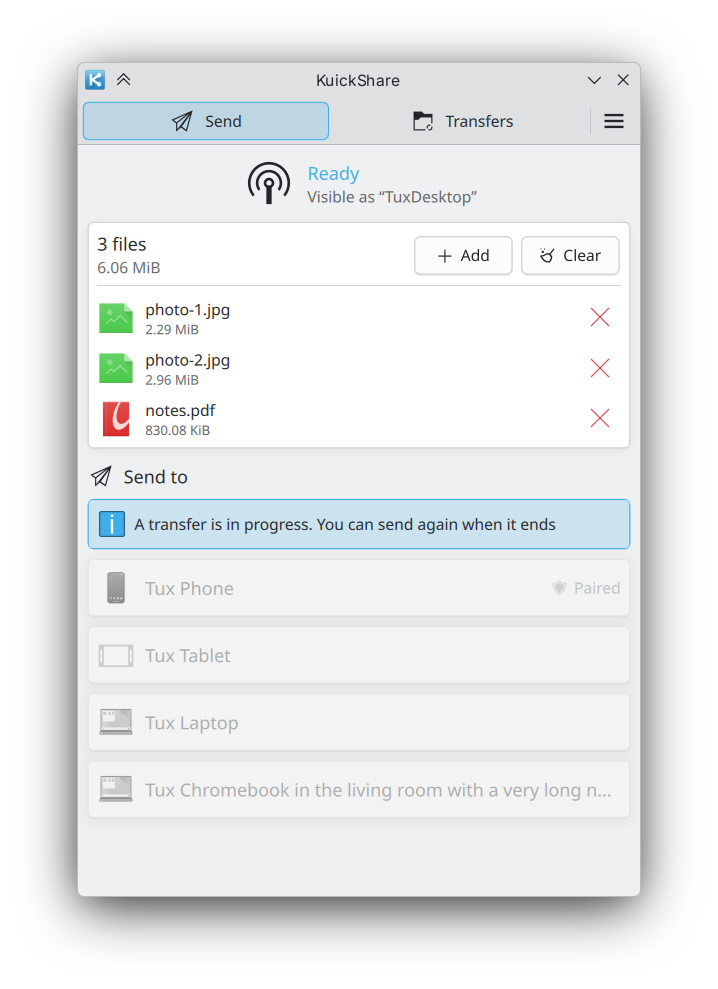
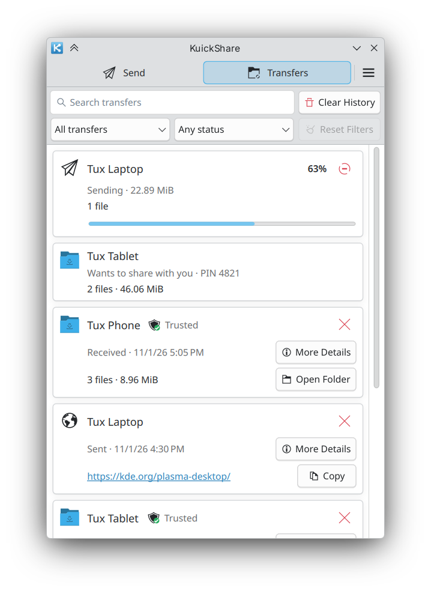

# KuickShare

<p align="center">
  
</p>

<p align="center">
  <b>Native KDE Plasma 6 app to send files, text and links to Android phones with Quick Share.</b><br>
  Send and receive with phones and other Quick Share devices on the same Wi-Fi network, with a Breeze interface, tray icon, Plasma notifications and a Dolphin menu entry.
</p>

<p align="center">
  <a href="https://github.com/the-beper/KuickShare/releases"></a>
  <a href="https://github.com/the-beper/KuickShare/releases"></a>
  <a href="https://github.com/the-beper/KuickShare/actions/workflows/ci.yml"></a>
  
</p>

> [!IMPORTANT]
> KuickShare began as a project for my own personal use, and is shared as is. Generative AI (Claude Code) assisted me in writing the code (almost all of the C++ and QML and a large part of the Rust core) and drafted the documentation and diagrams.

<table>
  <tr>
    <td></td>
    <td></td>
  </tr>
</table>

## Why

[Packet](https://github.com/nozwock/packet) is a good Quick Share client, but it is a GTK4 + libadwaita app built for GNOME. KuickShare started from it and keeps its protocol work, with an interface written for Plasma.

KDE Connect would be the natural choice, but its data transfer has been unreliable on my machine. The problems seem related to `wpa_supplicant`, and switching to `iwd` would make my Wi-Fi card stop working.

## What it does

**Send and receive**
- Files, text and links with phones and other Quick Share devices on the same Wi-Fi network.
- Drag and drop, clipboard paste and **Send with KuickShare** in Dolphin.
- Accept or decline incoming transfers from a notification; progress shows in Plasma's job tracker.

**Devices and history**
- Trusted devices (matched by name and MAC address) and paired KuickShare computers (8-digit code) can send without asking.
- History of past transfers, with automatic cleanup.

**Desktop integration**
- Tray icon, start at login, Do Not Disturb aware.
- English and Italian interface.

**Experimental, off by default**
- Send to and receive from a phone that shares no network with the computer, over Bluetooth and a temporary Wi-Fi link. See [Wi-Fi upgrade](docs/wifi-direct.md).

> [!NOTE]
> AirDrop cannot be supported. It needs Apple's AWDL Wi-Fi link, which on Linux works only with a few Wi-Fi chips that allow monitor mode and packet injection. Google's AirDrop support in Quick Share on Pixel phones relies on Android-side code and does not change the Quick Share protocol KuickShare speaks.

## Install

Three packages, all for KDE Plasma 6:

| Package | For | How |
|---|---|---|
| Flatpak | Any distribution | Add the repository and install (below); updates arrive through the software center |
| AppImage | Any distribution | Download it from the [releases](https://github.com/the-beper/KuickShare/releases), make it executable and run it. It brings its own libraries and installs nothing; use it with an AppImage manager such as [Gear Lever](https://github.com/mijorus/gearlever), [AM / AppMan](https://github.com/ivan-hc/AM) or [soar](https://github.com/pkgforge/soar) |
| Tarball | Fedora and distributions with Qt 6 and KDE Frameworks 6 | Download `KuickShare-<version>-x86_64.tar.gz`, extract it and run `install.sh`: it installs into `~/.local` and uses the system libraries |

```sh
flatpak remote-add --if-not-exists kuickshare https://the-beper.github.io/KuickShare/kuickshare.flatpakrepo
flatpak install kuickshare io.github.the_beper.KuickShare
```

Or open [kuickshare.flatpakrepo](https://the-beper.github.io/KuickShare/kuickshare.flatpakrepo) with the software center (Discover, GNOME Software). The KDE runtime comes from [Flathub](https://flathub.org/setup), which must be set up.

Update, uninstall and requirements are in the [usage guide](docs/usage.md).

## Documentation

- [Usage](docs/usage.md): install, update, uninstall, everyday use, trusted and paired devices.
- [Architecture](docs/architecture.md): design, security model, packaging.
- [Wi-Fi upgrade](docs/wifi-direct.md): transfers without a shared network (experimental), how it works, requirements, limits, open work.
- [D-Bus API](docs/dbus-api.md): the interface of the background service.
- [Contributing](CONTRIBUTING.md): build, tests, translations, releases.
- [Security](SECURITY.md): reporting a vulnerability, known limits.
- [Changelog](CHANGELOG.md): release notes.

## Credits

KuickShare is derived from [Packet](https://github.com/nozwock/packet) and uses [`rqs_lib`](https://github.com/nozwock/rquickshare) for the Quick Share protocol. Dependencies are listed in [THIRD_PARTY.md](THIRD_PARTY.md).

## License

GPL-3.0-or-later. See [LICENSE](LICENSE), and [THIRD_PARTY.md](THIRD_PARTY.md) for the third-party code and data it uses.

*KuickShare is an independent open-source project, not affiliated with or endorsed by Google.*
