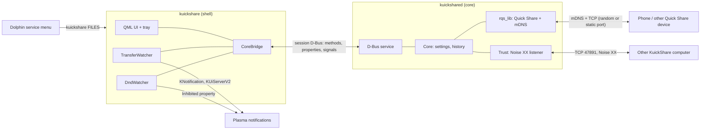
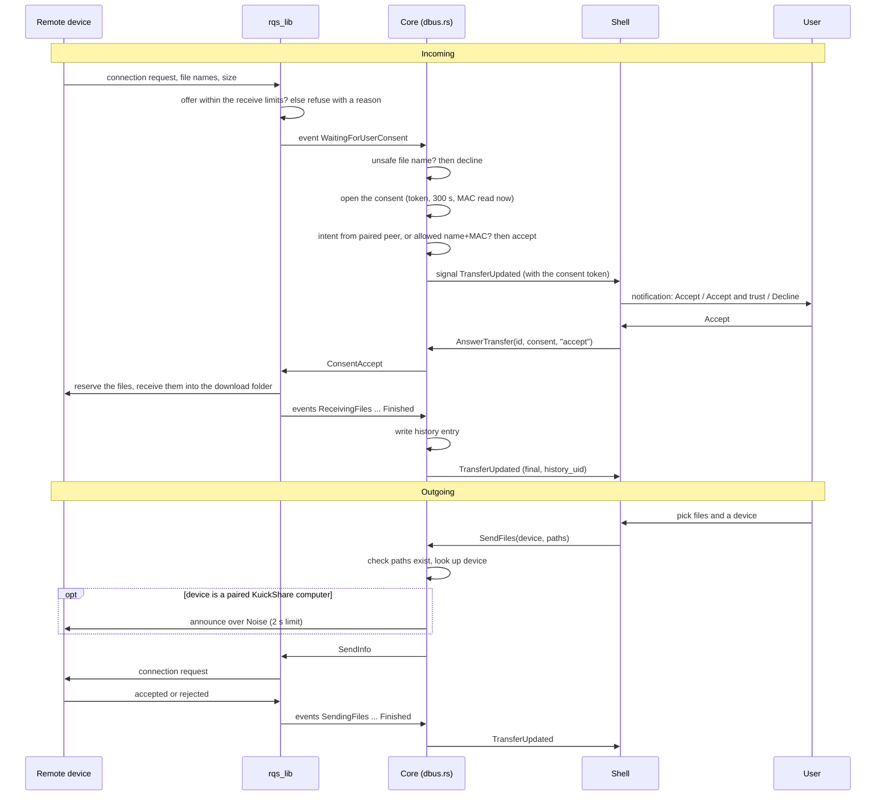
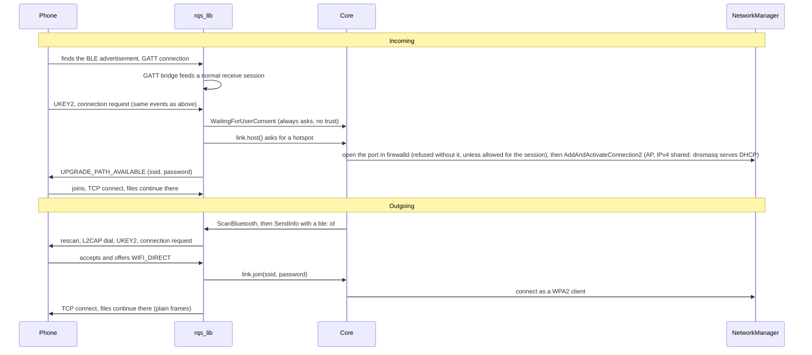
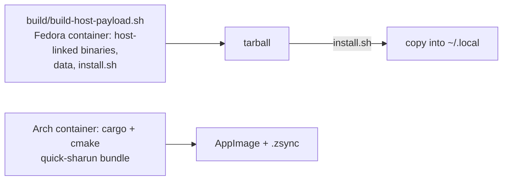
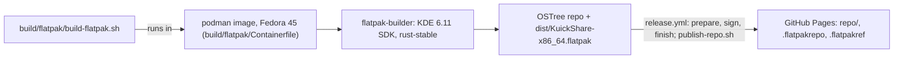

# Architecture

How KuickShare is put together and what it does and does not protect against. For the D-Bus members see [dbus-api.md](dbus-api.md); for day-to-day use see [usage.md](usage.md); for reporting a vulnerability see [SECURITY.md](../SECURITY.md).

- [Process model](#process-model)
- [Transfer data flow](#transfer-data-flow)
- [Transfer lifecycle](#transfer-lifecycle)
- [Files on disk](#files-on-disk)
- [Trust model](#trust-model)
- [Threat model](#threat-model)
- [Display of remote names](#display-of-remote-names)
- [Testing](#testing)
- [Packaging](#packaging)

## Process model

Two processes talk over the session D-Bus (`io.github.the_beper.KuickShare`, interface `...KuickShare1`).

| Process | Source | Language | Job |
| --- | --- | --- | --- |
| `kuickshared` (core) | `src/core/` | Rust, tokio, zbus | Quick Share protocol through `rqs_lib` (vendored path dependency, see [THIRD_PARTY.md](../THIRD_PARTY.md)), discovery, trust channel, settings, history |
| `kuickshare` (shell) | `src/shell/` | C++20, Qt 6, KF 6, Kirigami | Window, tray, notifications, progress jobs, Dolphin entry, Do Not Disturb |

The shell creates its window and QML engine only while the window is shown and destroys them on hide, so a hidden shell holds just the tray and the core connection. The split keeps the protocol code in Rust, where the library lives, and the desktop integration in Qt/KF6, where the bindings are mature. It also lets the core run and be tested without any UI (see [Testing](#testing)). The shell holds no protocol state: after a reconnect it reloads everything from the core.

### Who starts whom

- The shell starts the core. At startup `CoreBridge` checks whether the bus name is owned. If it is, the shell attaches to that core. If not, it runs `kuickshared` from its own directory with `QProcess`.
- The shell is single-instance (`KDBusService::Unique`). A second launch of the same version, for example from Dolphin, only queues its files in the running window.
- A launch of a different version, or with `--replace`, first asks the running shell to `quit()` over D-Bus (`src/shell/instance.cpp`), waits up to 8 s for it and 3 s for its core to leave the bus, then starts normally. An update therefore takes over a shell left in the tray. A transfer running in the old shell is lost.
- `UpdateWatcher` (`src/shell/updatewatcher.cpp`) notices an update installed under a running Flatpak (portal update monitor) or AppImage (the `$APPIMAGE` file replaced, after 5 s without changes). Once no transfer is active and the window is closed, `main.cpp` starts `kuickshare --replace` (Flatpak: portal `Spawn` with the latest version; AppImage: the file). It does so when the update arrives, when the window closes, every 30 s while waiting, and when the user opens the window from the tray icon or its "Open KuickShare" entry (then without `--background`, so the new version opens it). With the window open, a banner offers "Restart" (`CoreBridge::restartForUpdate`, disabled during a transfer), which starts the replacement the same way without `--background`. While a replacement is starting, further triggers are ignored for 15 s. The tarball installer restarts the app itself. Both watchers are unverified on a real desktop *(inferred from the portal specification)*.
- On exit the shell sends SIGTERM to a core it started and waits up to 3 s. A core it only attached to is left running. The core stops its engine on SIGTERM or Ctrl+C.
- Autostart is a `.desktop` file in `~/.config/autostart` that runs `kuickshare --background`.

### When the core is down

`CoreBridge` watches the bus name. When the owner disappears it marks itself disconnected and clears the device list, and the window shows an error banner with a "Start service" button. Nothing is restarted automatically. The button kills a core that is running but not on the bus, then starts a new one. When the name reappears the shell reloads properties, history, paired devices and the allowed list, and drops its transfer rows. A transfer in progress when the core died is lost.

### Inside the core

| Module | Role |
| --- | --- |
| `main.rs` | Loads settings, history and trust, serves D-Bus, starts the engine, waits for a signal |
| `app.rs` | `Core`: owns the `rqs_lib` engine and the settings. Settings that change the device name or port rebuild the engine, and the old values are restored if that fails |
| `dbus.rs` | The D-Bus interface, plus forwarder tasks that turn library events into signals and take each incoming transfer through the consent book (name guard, open, auto-accept) |
| `consent.rs` | `Consents`: the one book of incoming transfers that wait for an answer, see [Consent and the guard](#consent-and-the-guard). It has its own lock and never takes the `Core` lock |
| `link.rs` | `NmLink`: the Wi-Fi link of the upgrade over NetworkManager's D-Bus (access point or join) and the saved join of "Join network"; it opens the hotspot's firewall port first and refuses the hotspot without it unless the session consent (`HotspotPolicy`) allows an open zone; see [Wi-Fi upgrade](wifi-direct.md) |
| `trust.rs` | Noise XX channel on TCP 47891: probe, announce, pairing |
| `allowed.rs` | Trusted devices by name and MAC |
| `safety.rs` | The file name rule, re-exported from `rqs_lib::safety` so that the core's guard and the library cannot disagree |
| `ratelimit.rs` | Per-address connection limit for the trust port |
| `wifi_credentials.rs` | In-memory store of received Wi-Fi credentials for "Join network" |
| `persist.rs` | The one way files are written, see [Files on disk](#files-on-disk) |
| `history.rs`, `settings.rs` | JSON persistence |
| `requirements/` | The Wi-Fi requirements engine: `facts` (what the probes saw), `rules` (rows and capabilities, pure), `policy` (the gate on turning the upgrade on), `engine` (runs the probes with time limits, caches, joins concurrent callers), `system` (the read-only probe on the system bus), `watch` (drops the cache when a service or device changes), `model` (the JSON report). One engine serves `WifiRequirements`, `WifiRequirementsChanged` and the gate in `change_wifi_upgrade`; it never takes the `Core` lock. See [Checking the requirements](wifi-direct.md#checking-the-requirements) |

Besides the session bus, the core holds two connections to the system bus for the requirements: the probe's (kept between runs, dropped when the bus is gone) and the watcher's (match rules only, no polling). Both are read-only and idle until the first report is asked for; the Wi-Fi link has its own connection.

Settings that restart the engine (device name, static port, reset) are refused while a transfer is active. A transfer with no event for 600 s counts as over, so a lost final event cannot block them forever.

At start the core removes leftover `kuickshare-*` NetworkManager profiles (unconditionally, bounded at 5 s) before it takes its D-Bus name; at stop it releases the Wi-Fi link within 2 s ([timings](wifi-direct.md#timings-and-timeouts)).

The core is behind one lock, but a send holds it only briefly: to take a snapshot at the start and to queue the send at the end. Choosing the route (the LAN probe, the mDNS restart, the Bluetooth lookup, see the timeouts in `choose_route`) and the announce to a paired computer run without it, so other D-Bus calls do not wait for them; if the engine restarted meanwhile, the send fails with "the service restarted". Answering a transfer (`AnswerTransfer`, `Accept`, `Decline`) and `Cancel` do not take the lock either: answers go through the consent book, and a Cancel marks a send that is still choosing its route so it is dropped before it is queued and ends as `Cancelled` (a Cancel in the instant between queuing and the library taking the send can still be lost; it is sent twice to narrow that window). A restart still holds the lock while the old engine stops (bounded: the library first, then the final events are drained; unfinished transfers end as `Disconnected`). At exit the engine stop is bounded to 0.8 s and the Wi-Fi cleanup always runs after it (2 s), within the shell's 3 s wait.

### Inside the shell

| Part | Role |
| --- | --- |
| `main.cpp` | Window, tray, single instance, starts the core |
| `corebridge.*` | `CoreBridge`: D-Bus client and the QML-facing state; `transferBusy` is true while a transfer is live and not just awaiting approval |
| `transfermodel.*` | `TransferModel`: live and history rows; `beginPending`/`failPending` show a send before the core reports it; `busy` and `transferEnded` feed the Send page and the toasts |
| `transferwatcher.*`, `transferjob.*` | Notifications and the Plasma progress job of each transfer |
| `transferfiltermodel.*` | `TransferFilterModel`: `TransferModel` narrowed by direction, status group and search text for the Transfers page |
| `devicemodel.*` | Nearby devices |
| `dndwatcher.*` | Do Not Disturb state |
| `autostart.*`, `integration.*`, `dolphinmenu.*`, `launcher.h`, `execquote.h` | Autostart and Dolphin entries, first-launch question, `Exec` quoting, AppImage and Flatpak path detection |
| `requirementsreport.h` | Parses and validates the requirements report (schema, size and row limits, text cleaned) and formats the diagnostic report |
| `qml/` | Pages (Send, Transfers, Settings, Help), dialogs (`WifiRequirementsDialog.qml` among them), and `ToastStack.qml`: transient messages shown on whatever page is open |

UI only renders: the shell parses and validates the requirements report, turns reason codes into texts, and never checks a service itself; a report older than its time to live, or from before a core restart, is shown as out of date.

## Transfer data flow

Transfer ids are `ip:port` of the remote side, or `ble:<endpoint>` for a phone found over Bluetooth. Event and method names below are shortened; see [dbus-api.md](dbus-api.md).

An announce that fails only logs a message. The transfer still goes out and the receiver asks its user.

### Over Bluetooth (experimental)

With the Wi-Fi upgrade setting on, a phone that shares no network with the computer takes the same path through `rqs_lib`, `Core` and the shell; only the first channel and the move to Wi-Fi differ. Details and status: [wifi-direct.md](wifi-direct.md).

If the move fails, the transfer stays on the Bluetooth channel (about 5 KB/s). The core reports a send that never starts within 40 s as a failed transfer (see [dbus-api.md](dbus-api.md#transfer-states)).

## Transfer lifecycle

The state names come from `rqs_lib` and are passed through unchanged as strings. The core only interprets a few.

| State | Meaning for KuickShare |
| --- | --- |
| `WaitingForUserConsent` (inbound) | Opens the consent (token, deadline, MAC read); the only state where auto-accept is evaluated. Any later state closes it |
| `SendingFiles`, `ReceivingFiles` | Counts as active for the shell (progress job, Do Not Disturb, blocking settings) |
| `Finished`, `Cancelled`, `Rejected`, `Disconnected` | Final. The transfer leaves the active set and is written to the history, except the final events the core itself emits without a history entry (see below) |

- The first final state wins. `Finished` may be followed by `Disconnected`; the second is ignored in the core and in the shell's `TransferModel`.
- Later events often carry less data than earlier ones, so the core merges events and keeps known fields.
- The library reports a refusal by the remote side as `Disconnected`. The shell shows "not accepted" when an outgoing transfer ends that way before any data moved.
- The core's guard may decline an inbound transfer at any non-final event that lists file names, not only at the consent request.
- When the engine stops for a restart (settings that rebuild it, `ResetSettings`) or at exit, each transfer that had no final event gets a final `Disconnected` from the core. It has no history entry.
- A `Cancel` of a send that is still choosing its route ends it with a `Cancelled` emitted before `Cancel` returns, also without a history entry.
- At exit the library stop is bounded (its own wind-down is 400 ms) and the engine stop takes 0.8 s in all; then the Wi-Fi cleanup runs (2 s), within the shell's 3 s wait ([timings](wifi-direct.md#timings-and-timeouts)). At a stop an inbound session sends Cancel and Disconnection, then a FIN, within 300 ms + 50 ms, so the phone is told before the socket closes.

## Files on disk

Paths follow the XDG variables; defaults are shown. All four JSON files are written through one helper (`persist.rs`): the bytes go to a uniquely named temporary file `.<name>.<16 hex digits>.tmp` in the same folder, created exclusively with mode 0600, synced, renamed over the target, and the folder synced. `settings.json`, `history.json` and `peers.json` are therefore 0600 after their next save; `identity.json` is written only when it is created, so one made by an older version keeps its mode. At start, leftover temporary files of our own pattern (and the old `<name>.tmp`) are removed. A file that cannot be read or parsed is moved aside to `<name>.bak`, or `<name>.bak.1`, `.bak.2`… when one exists (a backup is never overwritten), and defaults are used. If it cannot be moved, saving that file is refused for the run, so it is never overwritten.

| File | Location | Contents | If unreadable or invalid |
| --- | --- | --- | --- |
| `settings.json` | `~/.config/kuickshare/` | All preferences, including the allowed (trusted by name and MAC) list | Moved aside to `settings.json.bak` (see above), defaults used |
| `identity.json` | `~/.local/share/kuickshare/` | Long-term Noise key pair, mode 0600, created on first start | The core refuses to start; the file is not touched |
| `peers.json` | `~/.local/share/kuickshare/` | Paired computers: name, public key, SHA-256 fingerprint, pairing time | Moved aside to `peers.json.bak` (see above), no paired computers |
| `history.json` | `~/.local/share/kuickshare/` | Finished transfers, newest first | Moved aside to `history.json.bak` (see above), treated as empty |
| Received files | Setting `download_dir`, else the library default (XDG download dir) | Written by `rqs_lib`: each name is reserved when the transfer is accepted (never overwriting: `name (1).ext`) and written through a directory handle, at most one file open at a time; see [Receive limits](#receive-limits) | An incomplete file is removed on cancel, decline, error, disconnect and timeout, but not after a crash, SIGKILL or power loss |
| Clipboard images | `<cache>/clipboard/` | PNGs saved to send a pasted image; the shell deletes those older than 1 h at startup | |
| Autostart entry | `~/.config/autostart/io.github.the_beper.KuickShare.desktop` | Written by the shell setting | |
| Installation | `~/.local/share/kuickshare/bin/`, `.desktop`, icons, `.mo`, service menu | See [Packaging](#packaging) | |

`--uninstall` keeps the first four rows; `--uninstall --purge` deletes them: the installer removes the whole `kuickshare` folders under the config and data directories, so backups (`.bak`, `.bak.N`) and leftover temporary files go too.

## Trust model

KuickShare takes part in ordinary Quick Share, where the sender is anonymous and every transfer needs the user's consent. On top of that it has two optional ways to skip the prompt. They are independent and can be switched off in the settings (trusted devices) or by not pairing.

| | Paired computer | Trusted device |
| --- | --- | --- |
| Works with | Another KuickShare installation | Any Quick Share sender, e.g. a phone |
| Identity | Noise static public key | Advertised name plus MAC address |
| Set up by | Pairing with a code compared on both screens | "Accept and trust" on a notification |
| Strength | Cryptographic for the announcement; the transfer itself is matched by IP | Weak: both values can be copied by a LAN attacker |

### Paired computers

The trust channel is a Noise XX handshake (`Noise_XX_25519_ChaChaPoly_BLAKE2s`, crate `snow`) over TCP 47891. The port is fixed so a peer can be reached knowing only its IP. The core listens on all interfaces. Both sides send their device name in the handshake payload. Frames are length-prefixed (2 bytes) and every read or write has a 10 s timeout. After the handshake the initiator sends one of three requests:

| Request | Effect |
| --- | --- |
| Probe | Answered for anyone. Says whether the caller's key is paired and whether the pairing window is open. Used during discovery to label cards "KuickShare" or "trusted" and to enable the card in the pairing dialog. That the window is open is therefore visible to anyone on the LAN, who could see it by trying to pair anyway |
| Intent | Accepted only from a paired key. Stores the peer's name for its IP for the intent lifetime ([limits](#limits-on-the-trust-port)), once |
| Pair | Accepted only while the user has opened the pairing window and the peer sent a non-empty name |

Pairing:

1. Both sides derive an 8-digit code (shown as `1234 5678`) from the first 4 bytes of the Noise handshake hash. A man in the middle would have to find a key pair that gives the same code on both sides; the source comment says 6 digits could be searched in under a minute and 8 digits cannot in the time the user has (estimate by the author, unverified).
2. Each user compares the codes and confirms or cancels within the confirmation time ([limits](#limits-on-the-trust-port)).
3. Each side sends its answer. Only if both said yes does each store the other's public key in `peers.json`.

Only one pairing may run at a time, so another host cannot take over the code on screen. Two computers count as trusted for sending only if each has the other's key; the probe checks both directions.

Receiving: when an inbound transfer asks for consent, the core looks for a still valid intent from the same source IP. If there is one, it accepts. The match is by IP address, not by key, so the transfer itself is not authenticated to the Noise identity (see [SECURITY.md](../SECURITY.md)). An intent not yet used is void after `Unpair`.

Sending: the core announces only to computers it saw as `trusted` in a probe.

### Trusted devices by name and MAC

"Accept and trust" on a consent notification (`AnswerTransfer` with `accept_and_trust`) stores the sender's name and its MAC address in the allowed list. The MAC is read from the kernel ARP table (`/proc/net/arp`) for the transfer's source IP **once, when the consent opens**, and stored with it; the answer binds that MAC, so it cannot be swapped between the prompt and the click. It fails, leaving the transfer waiting, if no MAC was read then (an incomplete entry, another network, IPv6, Bluetooth), if the address now has a different MAC, or if the sender has no name; the user can still accept without trusting. The legacy `AllowDevice` works only while the transfer waits, or within 30 s after the user accepted it (never after an automatic accept).

A later transfer is accepted without asking if the option is on, the name is non-empty and both name and MAC (read when its consent opened) match an entry. The MAC is looked up only when the option is on.

Older versions recognised a device by name and address alone. Because both can be copied, their lists were deleted once on upgrade, and the shell shows a notice until the user acknowledges it (`TrustedDevicesReset`, `AcknowledgeTrustedDevicesReset`). The feature stays: it is optional and now bound to the MAC read at the prompt, which still does not authenticate the sender.

> [!WARNING]
> Name and MAC are both set by the sender. Anyone on the same network who copies them is accepted without a prompt. The file name guard and the receive limits still apply, but the files are written to the download folder. Use this only on networks you trust.

### Consent and the guard

- **One consent book** (`consent.rs`). Every incoming transfer that waits for the user has an entry with a random token, a 300 s deadline, and the device name, address and MAC address seen when it opened. Every way of accepting it goes through `Consents::resolve`: the D-Bus methods, the paired-computer and the trusted-device auto-accept. The entry is removed before the answer is sent, so a consent is answered once even when answers race, an expired consent is never accepted (an accept after the deadline declines it), and a prompt that outlived its transfer cannot answer a new one under the same id: the token (`consent` in `TransferUpdated`, the argument of `AnswerTransfer`) differs, as does a new PIN under the same id. Restarting the service clears the book, and events of the stopped engine are ignored. The legacy `Accept`, `Decline` and `AllowDevice` have no token and cannot tell a reused id.
- **The token is not a secret.** It travels in a signal every client of the session bus can read, and `Accept` needs none: it guards against a stale prompt, not against another process of the same user (see the threat model).
- **Caps.** At most 32 transfers wait at once, at most 4 from one network address, and 8 of the 32 places are kept for Bluetooth senders (`ble-N`), so a flood over the network cannot get the one phone that sends over Bluetooth declined. Past a cap the transfer is declined and the refusal is logged at most once in 10 s.
- **Consent timeout.** An inbound transfer waiting for an answer is declined after 300 s, by one ticker in the core. The library has its own ceiling of 330 s on the wait, for a core that missed the event (see [Receive limits](#receive-limits)).
- **File name guard** (`safety.rs`). The names are checked in the library (`rqs_lib::safety`, also when the files are created) and the core re-uses the same rule, so a transfer is declined for a name that is empty, `.` or `..`, longer than 255 bytes, or contains `/`, `\`, a control character or an invisible or direction-changing character (U+200B, U+200E and U+200F, U+202A to U+202E, U+2060 to U+2064, U+2066 to U+2069, U+FEFF). The zero-width joiners U+200C and U+200D are allowed: Persian text and emoji sequences need them. The core's check runs before consent and before auto-accept, so no rule can bypass it.

### Receive limits

`rqs_lib` checks an offer before the user is asked and bounds what an unknown sender can make a session do (`Limits` in `third_party/rqs_lib/src/safety.rs`; a refusal reaches the app as `reason`, see [dbus-api.md](dbus-api.md#refusal-reasons)).

| Limit | Value |
| --- | --- |
| Files in one offer | 10,000; a larger offer is refused whole |
| Declared sizes | Negative sizes and sums that overflow are refused; two files with one payload id are refused |
| Free space | The offer must fit with 32 MiB left over; the download folder must be usable, and is not created by the offer |
| In-memory payloads (text, URLs, Wi-Fi, sharing frames) | 5 MiB each; 1 open before the accept, 4 after |
| Frame length | 5 MiB; a body is read as it arrives, not allocated from the announced length |
| Handshake | 90 s from the start of a session to the offer |
| Without a byte from the sender | 60 s; not counted while the user decides nor during a Wi-Fi upgrade |
| Wait for the user | 330 s in the library; the core's 300 s comes first |
| Frame writes | Each has a deadline; a stream whose write failed is not written again |
| LAN sessions at once | 32, and 4 from one address (the LAN listener only; the Bluetooth receiver takes one session at a time) |
| Files open at once | 1, and only while its data arrives |

What a session does with files:

- Nothing is written before consent: file data and text sent before the accept are refused.
- Each file is reserved at accept (`O_CREAT | O_EXCL | O_NOFOLLOW`, relative to the download folder opened at the offer), so a transfer never overwrites a file and a folder replaced since the offer is refused.
- `Finished` comes only after every file has its declared size and was synced.
- A file that is not finished is removed on cancel, decline, error, disconnect, timeout and panic. Only SIGKILL and power loss can leave one behind.
- The memory a session can hold before consent is about 10 MiB (one frame and one in-memory payload, 5 MiB each) *(inferred from the two limits, not measured)*.

### Limits on the trust port

| Limit | Value |
| --- | --- |
| Connections per address | 30 per 60 s; refused attempts do not extend the block |
| Open connections per address | 4 |
| Open connections in total | 32 |
| Idle time per read or write | 10 s |
| Intent lifetime | 60 s, used once |
| Pairing window | 5 min, opened by the user |
| Pairing confirmation | 120 s |

Refused connections are closed without a reply.

### History caps

| Cap | Value |
| --- | --- |
| Files kept per entry | 200 |
| Text kept per entry | 10,000 characters |
| Age | `history_keep_days` (0 keeps everything); applied on load, on add and on read |
| Number of entries | 1000 (`MAX_ENTRIES` in `src/core/history.rs`), the oldest go first; applied on load, on add and on read |
| Off switch | `history_enabled`; when off nothing is recorded |

Wi-Fi credentials are recorded by network name only, never the password. The password lives only in the short-lived memory store described in [Wi-Fi credentials from a phone](#wi-fi-credentials-from-a-phone).

### Wi-Fi credentials from a phone

A phone can share a Wi-Fi network with the computer. `rqs_lib` hands the core the password inside the transfer metadata; the core keeps it only for "Join network".

| Rule | Detail |
|---|---|
| Where | `Store` in `src/core/wifi_credentials.rs`, keyed by the transfer id used on D-Bus; memory only |
| Stored when | An inbound transfer with a Wi-Fi payload reaches `Finished` |
| Dropped when | A join succeeds; the transfer is rejected or cancelled; 10 minutes pass; the service restarts; the daemon exits. At most 8 are kept, the oldest go first |
| Never in | D-Bus signals or properties (`TransferUpdated` has the network name in `text` only), the history, the settings, logs (`Debug` of `TransferPayload` and of the store entries prints `<redacted>`; the library's Wi-Fi parser errors no longer quote the payload) |
| Joinable | WPA/WPA2 passphrases (8 to 63 characters; a 64-hex PSK is refused) and open networks; WEP and unknown security types are kept without a password and `JoinNetwork` refuses them. SSIDs starting with `kuickshare-` are refused: the sweep of temporary profiles would delete them |
| Join | `NmLink::join_saved` in `link.rs`: one NetworkManager profile named after the SSID, saved to disk, autoconnect on, normal routing and DNS (unlike the temporary upgrade profile `kuickshare-join`, which is memory-only and never takes the default route). On failure the profile is removed and the previous connection restored. A profile that already exists for the SSID is not looked up, so a second one is added *(inferred)*. The join runs in its own task, so it ends (and frees the link) even if the D-Bus caller goes away; worst case about 15 s |
| Guard | Refused while a transfer is in flight (the core's active-transfer list) or while the Wi-Fi upgrade holds the link (`NmLink` allows one session at a time) |

The shell shows the button from the transfer row alone (payload kind `WiFi`, inbound, finished, live row), not from a D-Bus key; if the credentials expired, `JoinNetwork` answers with an error.

### What the core never does

- Accept a transfer with an unsafe file name, or with no consent, intent or allowed-list match.
- Pair without the window open, with an unnamed computer, or without both users confirming.
- Connect to a non-local address because an mDNS advert named one. Probes go only to private, link-local and loopback addresses, at most once per 20 s per address.
- Write a Wi-Fi password to disk, put it on D-Bus or in a log (it is kept in memory only, for at most 10 minutes: see [Wi-Fi credentials from a phone](#wi-fi-credentials-from-a-phone)), or send the private key anywhere.
- Open links or run received files. The shell opens a link only when the user clicks.
- Read the contents of the files being sent, apart from handing their paths to the library.

What `rqs_lib` itself does on the network is not audited here (unverified).

## Threat model

Assumes the attacker is on the same LAN, or a malicious app runs as the same user. A passive observer of the Quick Share connection is a protocol matter and out of scope.

| Threat | Mitigation | Residual risk |
| --- | --- | --- |
| Sender uses a path in a file name to write outside the download folder | Name guard declines the transfer | Names that are valid but misleading (long, unusual Unicode) still pass |
| Sender hides the real extension with direction characters | Guard rejects them in file names; the shell neutralises markup in names | The shell does not strip direction characters from device names |
| Unknown sender floods the user with requests | Each request needs consent and expires after the consent timeout; at most 32 wait at once (4 per address, 8 kept for Bluetooth), the rest are declined; the library holds at most 32 LAN sessions and 4 per address | Many addresses can hold the 32 LAN slots until the handshake and idle limits expire (90 s, 60 s); each session can hold about 10 MiB before consent |
| Partial files, no disk space check, any size | The library refuses an offer that is too large, has too many files or does not fit the free space with a reserve; files are reserved at accept, never overwritten, and removed when not finished | A crash, SIGKILL or power loss can leave a partial file; a sender can still fill the disk up to the free space minus the reserve with a transfer the user accepts |
| A stale prompt answers a newer transfer under the same id, or two answers race | One consent book: token per transfer, answered once, the entry removed before the answer is sent | The token is readable by any client of the session bus, so another process of the same user is not stopped by it |
| Man in the middle during pairing | Noise XX plus an 8-digit code compared by both users | The user confirms without comparing |
| Stranger starts a pairing | Pairing window must be opened by the user, expires, one at a time, needs both confirmations | While open, anyone on the LAN can make a code appear; the user must decline |
| Copy of name and MAC of a trusted device | MAC from the ARP table read when the prompt opened, same link only, option can be turned off; the lists of older versions (name and address only) were deleted once, with a notice | A LAN attacker can set both and is accepted silently |
| Hijack of the intent window of a paired computer | Intent needs a paired key, short-lived, used once, void after `Unpair` | Matched by source IP, so a host that can take that IP and reach the Quick Share port in that time is accepted |
| Flood of the trust port | Per-address rate limit, per-address and global caps, 10 s timeouts | Many addresses can fill the 32 slots and delay probes and pairing; transfers by consent still work |
| mDNS advert makes the core connect to an outside host | Probe only to local addresses | Any local address can be probed (a TCP connect to the trust port) |
| Theft of the identity key | File mode 0600, written through a private temp file | Not encrypted; another process of the same user can read it |
| Other process on the session bus calls the API (accept, trust, send, allow the open firewall zone) | None seen in the interface code: no check of the caller. The consent token only guards against stale prompts; `RequestWifiUpgrade` can grant the firewall consent to any caller | Same trust boundary as the user's session |
| A session client makes the core probe the system services (`WifiRequirements`) | The probes are read-only (`NoAutoStart`, polkit without interaction), one check runs at a time and forced calls are held to one run per 2 s; the report carries no SSIDs, MACs, IPs or device names | Any client of the session bus can still cause a probe and read the report, which says which services are missing. Read-only is by the code and fake-service tests, not observed on real services |
| Huge metadata bloats the history | Caps on files and text per entry | Entry count is bounded only by age |
| Rich-text or HTML injection through a remote name or text | Shell escapes names and text in notifications, labels use plain text | See next section |
| Leak of Wi-Fi password through the history, D-Bus or logs | Only the network name is kept; the password is never written to disk and stays in a bounded in-memory store (`wifi_credentials.rs`) whose `Debug` output is redacted, also in `rqs_lib` | The password is in the core's memory for up to 10 minutes (a process of the same user could read it) |
| Another process on the session bus joins the computer to a phone's network | None: `JoinNetwork` does not check the caller, like `Accept`; it needs a transfer id with stored credentials, and the password is never sent to the caller | Same trust boundary as the user's session. A transfer started during the join (up to about 15 s) can lose its connection |
| Forged "trusted" display on a card | The trust label comes from the core's probe, not from the advert | Depends on the probe being correct |
| A nearby device uses the Bluetooth receiver (setting on) to read or cut a session | Only the device that opens the session with a valid connection request can write to it; one session at a time, new ones refused while one is live; a transfer still needs the user's consent and is never auto-accepted (ids `ble-N`) | A device can claim the slot in the instant between the phone's subscribe and its first write, and hold it while it keeps writing |
| A peer's upgrade offer points the computer at a hostile network | SSID and password are validated, the gateway must be a private address, the profile never takes the default route or DNS and is kept in memory | The computer joins a network chosen by the peer |
| The access point on the user's radio | Random 32-character key, profiles deleted afterwards and at start (unconditionally, before the D-Bus name is taken); NetworkManager's `dnsmasq` serves DHCP, so the daemon holds no extra privilege. The upgrade port is opened in firewalld's `nm-shared` zone first; if that fails the hotspot is refused before NetworkManager is touched and the transfer stays on Bluetooth (`WifiUpgradeBlocked`) | Only the upgrade port is open to whoever joined. With the user's consent for the session (memory only, revoked by a restart, `ResetSettings`, turning the upgrade off or the legacy `WifiUpgrade` write; revoking tears down an open-zone hotspot) a firewalld refusal uses the `trusted` zone and every port is open, and a missing firewalld leaves the zone to NetworkManager, where another firewall may still block the phone or leave the ports open. Cleanup at stop is bounded at 2 s, so after a timeout or a crash a hotspot or a port may remain until the next start. Not hand-tested with a phone |

## Display of remote names

Remote names are data chosen by the sender. The shell handles them in three places:

- `CoreBridge::plain()` replaces `<` and `>` with the single angle quotes U+2039 and U+203A, so a name cannot be read as rich text by a label. It is applied to device names, file lists, trusted and allowed device names, and pairing peer names and messages, whether they come from live signals or from the history.
- Notifications (`TransferWatcher`) pass device name, PIN and text preview through `toHtmlEscaped()`. The preview is shortened first.
- The text preview and the history text in the transfers page use `Text.PlainText`.

Not done: direction and zero-width characters are not removed from names shown in the UI. The core's guard covers file names only, so a device name can still contain them.

The "Open link" action appears only for received text that is a single `http://` or `https://` URL without spaces.

## Testing

Everything below runs in CI (`.github/workflows/ci.yml`) through `build/check.sh` in the Fedora 45 build image, with `QT_QPA_PLATFORM=offscreen`, together with `cargo fmt --check`, Clippy with `-D warnings` and `qmllint` (see [CONTRIBUTING.md](../CONTRIBUTING.md#checks)).

| Layer | Where | Covers |
| --- | --- | --- |
| Rust unit tests | `#[cfg(test)]` in `src/core/*.rs` | Name guard, rate limiter, ARP parsing and the trusted-sender rule, settings round trip and defaults, history, stale transfer cleanup, event merging, local-address filter, final states, code format. `trust.rs` tests run two real nodes over loopback: pairing, declined pairing, strangers refused, unnamed computer, unpair, per-address and global connection limits |
| Rust integration | `tests/core/dbus_api.rs` | Starts the real `kuickshared` binary and drives its D-Bus API as the shell does: default settings, persistence, reset, history remove, clear and expiry, legacy entries without an id, trusting an unknown transfer |
| Qt tests | `tests/shell/`, run by `ctest` | `TransferModel` (merging, final-state handling, history rows), `TransferFilterModel`, `DeviceModel`, Dolphin menu entry writing, Exec quoting |
| `rqs_lib` | `cargo test -p rqs_lib` (not part of the root run: it is not a workspace member) | The upgrade hand-over, plain and encrypted, the Bluetooth receiver and sender and the scanner, in memory and over loopback, with a fake `WifiLink` |
| Hardware | `#[ignore]` tests in `rqs_lib` (`hdl::ble_scan`, `hdl::ble_send::dial`) | Scan, dial and send with a real adapter and phone, run by hand outside the container; see [Wi-Fi upgrade](wifi-direct.md) |

The integration tests never touch the desktop's bus. Each test starts its own `dbus-daemon` on an abstract socket with a generated config (no service activation), and runs the core with `DBUS_SESSION_BUS_ADDRESS`, `HOME`, `XDG_CONFIG_HOME` and `XDG_DATA_HOME` pointing into a temp directory. `dbus-daemon` must be installed.

Not covered by automated tests:

- Real Quick Share transfers (with a phone or between two instances): the consent book and `consent_step` (consent, auto-accept, name guard) are tested with events made by hand and a fake MAC reader, and the library's receive limits and file handling with in-memory sessions; none of that ran against a phone. BLE, Wi-Fi and NetworkManager have no automated test with a real device: the firewall refusal and consent of the hotspot are tested against a fake NetworkManager and firewalld only.
- Pairing between two real computers; it is tested over loopback only.
- `CoreBridge`, notifications, progress jobs and the QML UI, beyond `qmllint`.
- The Flatpak: only the headless smoke test above. Notifications, job progress, the file chooser and Dolphin reading the entry are unverified.
- The AppImage: `build/appimage/test-appimage.sh` is a headless smoke test in bare containers (Debian, Alpine, NixOS, and Ubuntu 22.04 under Xvfb without Wayland: the main window appears within 10 s). Following the desktop theme, tray, notifications, file dialogs, GPU rendering, Wayland and the first-launch dialog are unverified on a real desktop. The tarball installer: `build/test-tarball.sh`, also headless.

## Packaging

Three packages ship the same sources:

| | AppImage | Tarball | Flatpak |
|---|---|---|---|
| Libraries | Its own (Arch, Qt 6 and KF6, with ld.so and libc): runs on any distribution | System Qt 6 / KF6 | `org.kde.Platform` 6.11 |
| Build | `build/build-appimage.sh` | `build/build-tarball.sh` | `build/flatpak/build-flatpak.sh` |
| Distribution | GitHub release, with `.zsync` update information | GitHub release | Release asset (bundle) and a signed OSTree repository on GitHub Pages |
| Dolphin entry, autostart | Written by the app when you say so, with `$APPIMAGE` as `Exec` | Written by the installer and the app | Written by the app at runtime into the host's folders, with `flatpak run` as `Exec` |

Outside the AppImage, every settings refresh runs `DolphinMenu::sync`, which makes the user's Dolphin entry match `dolphin_integration`: it writes it when on and no copy exists in the home or in a system data folder (so a package that does not ship it still gets the menu), and removes it when off. A packaged copy in `/usr/share/kio/servicemenus` is never touched, so turning the setting off does not hide it *(inferred, not tried on Plasma)*. The AppImage skips the write, so the first-start question stays the only way to add the entry.

### AppImage

Built the [Anylinux](https://github.com/pkgforge-dev/Anylinux-AppImages) way, in the Arch image `build/appimage/Containerfile.arch`, with `quick-sharun` (pinned by commit and SHA-256 in the Containerfile; it pins and checks `sharun`, `appimagetool` and the other helpers it downloads).

| Bundle | Content |
| --- | --- |
| Binaries | `kuickshare`, `kuickshared` |
| Runtime | The dynamic loader and libc, Qt 6 and KF6, the Qt and KF6 plugins |
| QML | Only the modules the UI imports (`DEPLOY_QML=1` would copy about 450 MB) |
| GPU drivers | None; the host's are used |
| Size | About 73 MiB |

- **Direct run.** The hook `build/appimage/anylinux.hook` (installed as `bin/00-kuickshare.hook`) lets a plain start run the bundled `kuickshare`. It sets `QT_QPA_PLATFORMTHEME=kde` (the bundle holds the Plasma platform theme and Breeze icons) so the app follows the host's theme, read from the host's `~/.config`.
- **Core.** `kuickshared` is started by the shell from its own folder. In the bundle it is a small script that runs the real binary (renamed `kuickshared-core`) through `sharun`, so it uses the bundled libc.
- **`$APPIMAGE`.** The AppImage runs from a temporary mount, so `Launcher::inAppImage()` (`src/shell/launcher.h`) makes the Dolphin, autostart and menu entries point at the `$APPIMAGE` file.
  - Detection: `APPIMAGE` names an existing file and the program is inside `APPDIR`. A tarball installation started from a terminal that inherited `APPIMAGE` is therefore not taken for the AppImage.
  - Nothing is written by itself: the first start asks once (`src/shell/integration.cpp`, `IntegrationDialog.qml`), and the Preferences toggles write entries on demand.
- **Updates.** `appimagetool` embeds `gh-releases-zsync|the-beper|KuickShare|latest|KuickShare-x86_64.AppImage.zsync` and writes the `.zsync` file, which the release publishes.
- **Cache.** The Podman volume `kuickshare-appimage` keeps the cargo registry; each build uses a fresh `TMPDIR` because `quick-sharun` does not re-check cached files.
- **Test.** `build/appimage/test-appimage.sh` runs the AppImage with `--appimage-extract-and-run` (no FUSE):
  - Where: bare Debian, Alpine and `nixos/nix` containers with only `dbus`, plus Ubuntu 22.04 with Xvfb and no Wayland (the main window appears within 10 s).
  - Checks: the core answers on D-Bus, no QML or plugin errors, only its own data is written, and a second launch hands its files over.

### Tarball

Built in three steps:

1. `build/build-host-payload.sh` builds `kuickshare` and `kuickshared` against the system's Qt 6 / KF6 in the Fedora image (`build/Containerfile`, started by `build/build-env.sh`, with the host's rustup and cargo mounted; the host needs no development packages).
2. The same script stages them in `dist/tmp/host` with the data files, the compiled translations (`msgfmt --check-format`, so a broken format string fails the build) and `build/appimage/install.sh`.
3. `build/build-tarball.sh` packs that folder with a top-level `install.sh` into a reproducible `.tar.gz`.

- **Host libraries.** Qt 6 and KF6 are not bundled in the payload ([THIRD_PARTY.md](../THIRD_PARTY.md) lists them). The installer checks with `ldd` for missing libraries and for the QML modules `org/kde/kirigami` and `org/kde/kirigamiaddons/formcard`, and prints the `dnf` or `pacman` command if something is missing.
- **Install.** Binaries are copied to a `.new` file and moved into place, so an update does not hit "text file busy". A running instance is stopped first (SIGTERM, then SIGKILL after 5 s) and restarted afterwards. The Dolphin entry is not reinstalled if `dolphin_integration` is `false` in the settings. `~/.local/bin/kuickshare` is linked only if it is missing or already ours. The translations go to `~/.local/share/locale/<lang>/LC_MESSAGES/kuickshare.mo`, where KDE looks for them.
- **Uninstall.** `~/.local/share/kuickshare/uninstall.sh` removes the files above. User data stays unless `--purge` is given.
- **Test.** `build/test-tarball.sh` installs, updates and uninstalls (`--purge`) in the Fedora image with a throw-away `HOME`.

### Flatpak

The manifest is [`build/flatpak/io.github.the_beper.KuickShare.yml`](../build/flatpak/io.github.the_beper.KuickShare.yml): one module for the Rust core (offline, with `cargo-sources.json` generated from `Cargo.lock` by `flatpak-cargo-generator`) and one CMake module for the shell.

- **Build environment.** The container runs in rootless podman (the scripts refuse a rootful one) with `--security-opt unmask=ALL --cap-add SYS_ADMIN --cap-add NET_ADMIN` instead of `--privileged`: bwrap needs `/proc` unmasked to mount its own and those two capabilities to create namespaces (they hold inside the container's user namespace only). Runtimes and the build cache live in the podman volume `kuickshare-flatpak`, not on the host.
- **Sandbox holes.** The permissions are listed in the [usage guide](usage.md#flatpak). The shell must own `org.kde.kuickshare` (`KDBusService`; the app does not start without it). The tray item registers with its connection name, so it needs no name of its own (tested against a fake watcher).
- **Paths.** Inside the sandbox `XDG_*` point to `~/.var/app/<id>`, so `src/shell/launcher.h` finds the host's folders for the Dolphin and autostart entries in `/proc/self/mountinfo`.
  - Flatpak mounts the granted `kio/servicemenus` and `autostart` folders there at their host paths. If none is found, the default is `$HOME/.local/share` and `$HOME/.config`.
  - `Exec` becomes `flatpak run --file-forwarding <id> @@ %F @@`, which hands the files to the sandbox through the document portal.
  - A download folder is accepted only under a mount that is not one of the sandbox's private ones (`/tmp`, `/run`, `/usr`, ...), or under a portal document or `/run/media`; otherwise files written there would be lost with the sandbox. This check is covered by unit tests on sample mount tables, not yet in a real sandbox.
- **Repository.** `release.yml` builds the commits unsigned and exports them on top of a clone of the `gh-pages` branch. Four jobs then make the signed site: `prepare-flatpak` (no key) adds them to the published repository, and `build/flatpak/publish-repo.sh` prunes it and writes the summary, `kuickshare.flatpakrepo` and `kuickshare.flatpakref` with the public key; `check-flatpak` (no key, another machine) checks what `prepare-flatpak` made and archives it; `sign-flatpak` (the only job with the secret `FLATPAK_GPG_PRIVATE_KEY`, approved once the checks are green) unpacks that archive against the hashes of `check-flatpak`, `prepare-flatpak` and `build-flatpak`, signs the new commits and the summary (ostree and flatpak still parse the commit objects and the config with the key at hand, content that was checked before) and makes no commit, appstream data or delta; `finish-flatpak` (no key) checks the result as a client with only the public key. There are no static deltas. The branch is replaced by a single commit each release so OSTree objects do not pile up in the git history. Details and the checks of each step: [CONTRIBUTING.md](../CONTRIBUTING.md#releases).
- **Test.** `build/flatpak/test-flatpak.sh` installs the bundle in a container with offscreen Qt, a private session bus, non-default `XDG_*` folders, a fake `StatusNotifierWatcher` and the document portal. It checks that:
  - the core answers on D-Bus;
  - the tray item registers;
  - the Dolphin entry lands in the host folder;
  - a file is forwarded to the sandbox;
  - a second launch hands over to the running instance.

  Notifications, job progress, the file chooser and Dolphin itself need a real Plasma session and are untested.
