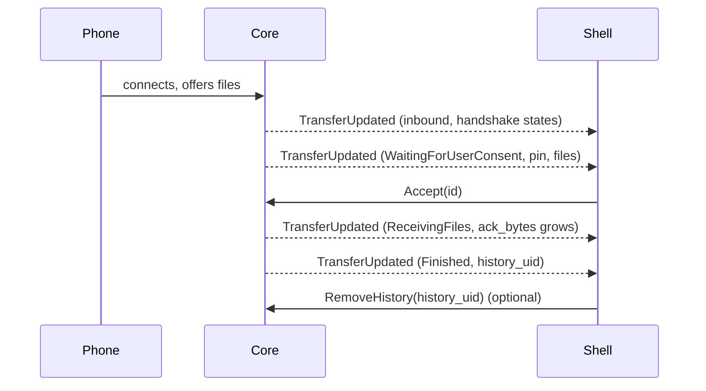

# Core D-Bus API

The core daemon `kuickshared` exposes everything the shell does through one object on the session bus. Any other client can use it the same way. Design and security model: [architecture.md](architecture.md). End-user guide: [usage.md](usage.md).

Contents: [Trying it](#trying-it) · [Methods](#methods) · [Properties](#properties) · [Signals](#signals) ([TransferUpdated](#transferupdated), [DeviceFound](#devicefound)) · [Transfer states](#transfer-states) · [JSON results](#json-results) ([History](#history), [Paired computers](#paired-computers), [Always-accepted devices](#always-accepted-devices)) · [Behaviour](#behaviour) ([Pairing and the trust port](#pairing-and-the-trust-port)) · [How the shell uses it](#how-the-shell-uses-it) · [Guaranteed by tests](#guaranteed-by-tests)

| | |
|---|---|
| Bus name | `io.github.the_beper.KuickShare` (session bus) |
| Object path | `/io/github/the_beper/KuickShare` |
| Interface | `io.github.the_beper.KuickShare1` |

Errors are `org.freedesktop.DBus.Error.Failed` with a human-readable message, unless stated otherwise. Methods that start work (`SendFiles`, `PairWith`, ...) return when the work is queued; the outcome arrives as signals.

## Trying it

Against a running core (the shell starts it, or run `kuickshared`):

```sh
D="--dest io.github.the_beper.KuickShare --object-path /io/github/the_beper/KuickShare"
I=io.github.the_beper.KuickShare1

gdbus introspect --session $D
gdbus call --session $D --method $I.History
gdbus call --session $D --method $I.StartDiscovery
gdbus monitor --session --dest io.github.the_beper.KuickShare   # signals

busctl --user get-property io.github.the_beper.KuickShare /io/github/the_beper/KuickShare $I Visible
busctl --user set-property io.github.the_beper.KuickShare /io/github/the_beper/KuickShare $I DeviceName s "Desk"
```

On a private bus, so the desktop session and the real settings stay untouched (this is what `tests/core/dbus_api.rs` does):

```sh
T=$(mktemp -d); mkdir -p "$T/config" "$T/data"
ADDR=unix:abstract=kuickshare-dev
cat > "$T/bus.conf" <<EOF
<busconfig><type>session</type><listen>$ADDR</listen><auth>EXTERNAL</auth>
<policy context="default"><allow send_destination="*" eavesdrop="true"/>
<allow eavesdrop="true"/><allow own="*"/></policy></busconfig>
EOF
dbus-daemon --config-file="$T/bus.conf" --nofork &

DBUS_SESSION_BUS_ADDRESS=$ADDR HOME=$T XDG_CONFIG_HOME=$T/config XDG_DATA_HOME=$T/data \
    cargo run --bin kuickshared &

gdbus call --address $ADDR --dest io.github.the_beper.KuickShare \
    --object-path /io/github/the_beper/KuickShare --method io.github.the_beper.KuickShare1.History
```

The private bus isolates D-Bus and files only: the daemon still advertises on the LAN through mDNS and listens on the trust port (see [Pairing](#pairing-and-the-trust-port)). The commands above were not run as written (unverified).

## Methods

IDs: a transfer `id` and a device `id` are both taken from `TransferUpdated` and `DeviceFound`.

| Id | Meaning |
|---|---|
| `ip:port` | A device on the network, or a transfer with it |
| `ble:<endpoint id>` (e.g. `ble:G483`) | A phone found over Bluetooth LE (`medium` `ble`); an outgoing transfer to it has the same id. Hex (`ble:0001ff41`) when the 4-byte endpoint id is not printable |
| `ble-<N>` | An incoming Bluetooth transfer; never a device id |

Bluetooth devices are listed only while `WifiUpgrade` is on, can be sent to but not paired with.

| Method | Signature | Description | Errors |
|---|---|---|---|
| `Accept` | `(s id)` | Accept an incoming transfer waiting for consent | Service not running |
| `Decline` | `(s id)` | Decline it | Service not running |
| `Cancel` | `(s id)` | Cancel a running transfer, either direction | Service not running |
| `StartDiscovery` | `()` | Start looking for nearby devices; reported by `DeviceFound` / `DeviceLost`. Does nothing if already on | Service not running |
| `FirewallManaged` | `() -> b` | Whether firewalld is running on the system bus. When it is not, the Wi-Fi upgrade cannot open one port and the hotspot uses the `trusted` zone; the shell asks for confirmation before turning the setting on | none |
| `ScanBluetooth` | `()` | Run one more Bluetooth LE scan window (a few seconds) for phones in Receive mode; results arrive as `DeviceFound`. The scan starts at once, then LAN devices that fail two TCP connection attempts of 1.5 s each are dropped (`DeviceLost`) before the call returns, so it can take about 3 s. Nothing is scanned or dropped when discovery is not running. Does nothing without `WifiUpgrade`, a Bluetooth adapter, while a scan or Bluetooth send runs, or within 4 seconds of the previous window | Service not running; discovery is not running |
| `StopDiscovery` | `()` | Stop looking and forget the devices found so far, so sending to one needs a new `StartDiscovery` | none |
| `SendFiles` | `(s device_id, as paths)` | Send files to a discovered device. A Bluetooth device is scanned for again first (up to 12 seconds) | Empty list; a path that cannot be read; unknown device; Bluetooth device while `WifiUpgrade` is off; service stopped |
| `SendText` | `(s device_id, s text, s kind)` | Send text. `kind` `"url"` sends a link, any other value sends plain text | Blank text; unknown device; Bluetooth device while `WifiUpgrade` is off; service stopped |
| `History` | `() -> s` | Finished transfers, newest first, JSON (see [History](#history)). Applies the retention first | none |
| `HistorySize` | `() -> t` | Size of the history file in bytes (0 if never written) | none |
| `RemoveHistory` | `(t uid)` | Delete one entry; an unknown `uid` is ignored | none |
| `ClearHistory` | `()` | Delete all entries | none |
| `SetPairing` | `(b open)` | Let other KuickShare computers start a pairing with this one. `true` opens a 5 minute window, `false` closes it | none |
| `PairWith` | `(s device_id)` | Start pairing with a discovered computer; progress arrives as `PairingCode` / `PairingFinished` | Unknown device; a `ble:` id |
| `ConfirmPairing` | `(b accept)` | Answer to `PairingCode`: do both screens show the same code? Ignored if no pairing waits | none |
| `Unpair` | `(s fingerprint)` | Forget a paired computer; emits `TrustedChanged` even if the fingerprint is unknown | none |
| `TrustedDevices` | `() -> s` | Paired computers, JSON (see [Paired computers](#paired-computers)) | none |
| `AllowDevice` | `(s transfer_id)` | Add the sender of an in-flight transfer to the always-accepted list | Transfer not in flight or sender without a name; MAC address not found in the kernel ARP table |
| `ForgetAllowed` | `(s name, s mac)` | Remove an entry from the list; unknown entries are ignored | none |
| `AllowedDevices` | `() -> s` | Always-accepted devices, JSON (see [Always-accepted devices](#always-accepted-devices)) | none |
| `ResetSettings` | `()` | Put every persisted property back to its default and restart sharing. The always-accepted list is kept; `Suspended` is not touched | A transfer is in progress; restart failed (settings are put back) |

`Accept`, `Decline` and `Cancel` only fail when the service is not running. An unknown or already finished `id` is not reported as an error (inferred from the code, which has no check for it).

## Properties

All properties are read-write. Persisted ones are saved to `~/.config/kuickshare/settings.json` (JSON keys in snake case, e.g. `history_keep_days`); a partial or missing file falls back to the defaults, an unparsable one is moved to `settings.json.bak`.

| Property | Type | Default | Persisted | Effect and errors |
|---|---|---|---|---|
| `DeviceName` | `s` | machine hostname (`Unknown device` if unreadable) | yes | Name shown to other devices. Trimmed and cut to 64 bytes (at a character boundary); empty restores the default. Restarts sharing; fails during a transfer. A value equal to the current one does nothing |
| `DownloadDir` | `s` | `""` (the library default, the XDG download directory) | yes | Trimmed; created if missing (fails if it cannot be). Applied immediately, no restart |
| `StaticPort` | `u` | `0` (random port at each start) | yes | `0` or 1024-65535, else an error. Restarts sharing; fails during a transfer, or if the port cannot be bound (settings go back to the previous value) |
| `Visible` | `b` | `true` | yes | Visible to nearby devices. The effective state is `Visible and not Suspended` |
| `Suspended` | `b` | `false` | no | Hides the computer without changing `Visible`. The shell sets it while Do Not Disturb is on |
| `HideWhenDnd` | `b` | `true` | yes | Stored only; the shell reads it and sets `Suspended` |
| `HistoryEnabled` | `b` | `true` | yes | Off: new transfers are not recorded (`history_uid` stays 0); entries already saved stay |
| `HistoryKeepDays` | `u` | `0` (keep for ever) | yes | Entries older than this are deleted, immediately and each time the history is read or written |
| `TrayIcon` | `b` | `true` | yes | Stored only; the shell shows or hides its tray icon |
| `DolphinIntegration` | `b` | `true` | yes | Stored only; the shell adds or removes the Dolphin entry |
| `TrustedDevicesEnabled` | `b` | `true` | yes | Whether the [always-accepted list](#always-accepted-devices) is honoured |
| `WifiUpgrade` | `b` | `false` | yes | Let transfers move to a temporary Wi-Fi hotspot (see [Wi-Fi upgrade](wifi-direct.md)); needs NetworkManager |

`ResetSettings` emits `PropertiesChanged` for every property it resets *(not run against a real client)*.

## Signals

| Signal | Signature | Emitted when |
|---|---|---|
| `TransferUpdated` | `(s id, a{sv} info)` | Every event of a transfer, in both directions; see [TransferUpdated](#transferupdated) |
| `DeviceFound` | `(s id, a{sv} info)` | A device is announced or announced again, and once more when the KuickShare check finishes; see [DeviceFound](#devicefound) |
| `DeviceLost` | `(s id)` | A device has not been seen for 4 seconds after it disappeared (for Bluetooth: after a scan window no longer saw it). Android changes its announced name every few seconds, so this grace period hides the lost/found flicker. Also sent at once for a LAN entry replaced by a new announcement with the same address, name and type (a restarted app), and by `ScanBluetooth` for an entry that no longer answers |
| `PairingCode` | `(s code, s peer)` | A pairing needs confirmation. `code` is 8 digits formatted `1234 5678`, derived from the handshake; compare it with the other screen, then call `ConfirmPairing` |
| `PairingFinished` | `(b ok, s peer, s message)` | A pairing ended. `message` is empty on success |
| `TrustedChanged` | `()` | The paired computers list changed (pairing completed or `Unpair`) |

A restart of sharing (name, port, reset) forgets the discovered devices without emitting `DeviceLost`; discovery continues if it was on.

### TransferUpdated

`info` is a fixed set of 14 keys. Later events of the same transfer often carry less than earlier ones (no device, no file names, zero sizes), so clients should keep the last non-empty value of each key.

| Key | Type | Meaning |
|---|---|---|
| `kind` | `s` | `inbound` or `outbound` |
| `state` | `s` | Library state name, see [Transfer states](#transfer-states); may be empty |
| `device` | `s` | Name of the other device; empty if not known yet |
| `pin` | `s` | Quick Share PIN to compare on both devices; empty if none |
| `preview` | `s` | Short description of the payload as the library gives it |
| `total_bytes` | `t` | Total size |
| `ack_bytes` | `t` | Bytes transferred so far |
| `payload_kind` | `s` | `Files`, `Text`, `Url` or `WiFi`; empty if not known yet |
| `files` | `s` | File names (inbound) or paths, one per line; empty for text |
| `saved_paths` | `s` | Inbound files: where each one was saved (after any `name (1).ext` renaming), one path per line; empty otherwise |
| `text` | `s` | Text or link; for `WiFi`, only the network name, never the password |
| `trusted` | `s` | Set when the transfer was accepted without asking: the paired computer's name, or the device name for an always-accepted device. Empty otherwise |
| `always_accepted` | `s` | Device name when the sender is on the always-accepted list; empty for a paired computer |
| `history_uid` | `t` | `uid` of the history entry written when the transfer ended; 0 on every other event and when the history is off |

### DeviceFound

`info` has 7 keys: six strings and the boolean `pairing`. The same device is usually reported twice: first as announced, then again after the core has checked whether it runs KuickShare.

| Key | Meaning |
|---|---|
| `name` | Advertised name |
| `ip` | Address; empty for Bluetooth |
| `port` | Quick Share port; empty for Bluetooth |
| `device_type` | `Unknown`, `Phone`, `Tablet` or `Laptop`; empty if not announced |
| `medium` | `lan` (mDNS) or `ble` (Bluetooth LE) |
| `trust` | `""` other device, `kuickshare` runs KuickShare, `trusted` paired with this computer (both sides). Only addresses on the local network (private, link-local, loopback, IPv6 ULA) are checked, each at most once every 20 seconds (the computers already known as KuickShare every 4 seconds while this computer's pairing window is open) |
| `pairing` | Boolean: the other computer runs KuickShare and has its pairing window open. `false` for other devices and until the first check; `true` for a KuickShare computer whose version does not report it (the pairing attempt then says whether it was refused) |

## Transfer states

`state` is the library's state name. The states that end a transfer:

| State | Final | Meaning |
|---|---|---|
| `Finished` | yes | Completed |
| `Cancelled` | yes | Cancelled by either side |
| `Rejected` | yes | Declined |
| `Disconnected` | yes | Connection lost |
| `WaitingForUserConsent` | no | Inbound transfer waits for `Accept` or `Decline` |
| `ReceivingFiles`, `SendingFiles` | no | Data is moving |
| `Initial`, `ReceivedConnectionRequest`, `SentUkeyServerInit`, `SentUkeyClientInit`, `SentUkeyClientFinish`, `SentPairedKeyEncryption`, `ReceivedUkeyClientFinish`, `SentConnectionResponse`, `SentPairedKeyResult`, `SentIntroduction`, `ReceivedPairedKeyResult` | no | Handshake steps of the protocol |

The library itself emits `Disconnected` for a send that fails before the transfer starts *(inferred from the library code, not reproduced)*. If a send hangs and no event comes for 40 seconds (`BLE_START_TIMEOUT`, `LAN_START_TIMEOUT` in `src/core/app.rs`), the core emits `Disconnected` for that id (outbound, no history entry).

Only the first final state of a transfer is recorded in the history. `Finished` can be followed by `Disconnected`; that second event has `history_uid` 0.



## JSON results

### History

`History()` returns an array, newest first. The file is `~/.local/share/kuickshare/history.json`.

```json
[{"uid":1760795000123,"time":1760795000,"kind":"inbound","state":"Finished","device":"Pixel","payload_kind":"Files","files":["a.jpg"],"text":"","total_bytes":482113,"trusted":false}]
```

| Field | Type | Meaning |
|---|---|---|
| `uid` | number | Identifier: Unix time in milliseconds, made unique. Entries saved before it existed get one derived from `time` |
| `time` | number | Unix time in seconds when the transfer ended |
| `kind` | string | `inbound` or `outbound` |
| `state` | string | Final state: `Finished`, `Cancelled`, `Rejected` or `Disconnected` |
| `device` | string | Name of the other device |
| `payload_kind` | string | `Files`, `Text`, `Url`, `WiFi` or empty |
| `files` | array of strings | At most 200 names kept |
| `text` | string | Text or link (at most 10 000 characters kept), or the Wi-Fi network name |
| `total_bytes` | number | Size |
| `trusted` | boolean | Accepted without asking (paired computer or always-accepted device) |

### Paired computers

`TrustedDevices()`; stored in `~/.local/share/kuickshare/peers.json`.

```json
[{"name":"desk","fingerprint":"9f2c...","public_key":"04ab...","paired_at":1760795000}]
```

| Field | Type | Meaning |
|---|---|---|
| `name` | string | Name the other computer had when pairing |
| `fingerprint` | string | SHA-256 of the public key, hex; the argument of `Unpair` |
| `public_key` | string | Hex |
| `paired_at` | number | Unix time in seconds |

### Always-accepted devices

`AllowedDevices()`; stored in `settings.json` as `allowed_devices`.

```json
[{"name":"Pixel","mac":"aa:bb:cc:dd:ee:01"}]
```

| Field | Type | Meaning |
|---|---|---|
| `name` | string | Advertised device name |
| `mac` | string | Lowercase, colon separated; read from `/proc/net/arp` |

An incoming transfer is accepted without asking only if `TrustedDevicesEnabled` is on and both the advertised name and the MAC the kernel has for the sender's address match an entry. A different MAC, an unknown MAC (other network, IPv6) or an empty name means the user is asked as usual. No signal is emitted when the list changes.

## Behaviour

| Topic | Behaviour |
|---|---|
| Consent timeout | An incoming transfer nobody answers is declined ([consent timeout](architecture.md#consent-and-the-guard)) |
| Unsafe file names | An inbound transfer with an empty name, `.`, `..`, a name over 255 bytes, or a name with `/`, `\`, control characters or invisible text-direction characters is declined before anything can accept it, whatever the trust rules say. No error reaches the caller; the transfer ends like a decline |
| Settings that restart sharing | `DeviceName`, `StaticPort` and `ResetSettings` stop and rebuild the service; discovered devices are forgotten, discovery resumes if it was on. They fail with `Wait for the current transfer to finish before changing this setting` while a transfer is in flight |
| Stale transfers | A transfer with no event for 600 seconds counts as over when checking the previous point, so a lost final event cannot block those settings for ever. Such a transfer never reaches the history |
| Failed restart | The previous settings are restored and the service is started again with them |
| History limits | 200 file names and 10 000 text characters per entry; entries older than `HistoryKeepDays` days are removed when the history is read, written, or the property changes |
| Automatic acceptance | Paired computers (announced over the trust port) and always-accepted devices get `Accept` from the core itself, and the event carries `trusted` |

### Pairing and the trust port

Pairing and paired-computer checks use a separate fixed TCP port (see [architecture.md](architecture.md#paired-computers)), Noise XX channel. If it cannot be bound, the core logs a warning and keeps working without paired computers.

| Rule | Value |
|---|---|
| One pairing at a time | A second attempt while one is waiting is refused with `Another pairing is in progress` and no `PairingFinished` is emitted for it |
| Code confirmation | `Nobody confirmed the code in time` when the time runs out |
| Pairing window | Opened by `SetPairing(true)`; the other computer must also have a non-empty name |
| Times and limits | See [Limits on the trust port](architecture.md#limits-on-the-trust-port) |

## How the shell uses it

`src/shell/corebridge.cpp` starts `kuickshared`, watches the bus name for owner changes, reads all properties and the three JSON lists when the core appears, and subscribes to all six signals. It reloads the paired computers on `TrustedChanged`, calls `HistorySize` after a transfer ends to warn about a big history, sets `Suspended` from Do Not Disturb, and stops discovery 30 seconds after the Send page is left.

## Guaranteed by tests

`tests/core/dbus_api.rs` runs the daemon on a private bus and checks:

- default values of `Visible`, `HistoryEnabled`, `TrayIcon`, `DolphinIntegration`, `TrustedDevicesEnabled`, `WifiUpgrade`, `HistoryKeepDays`, and that `History` and `AllowedDevices` start as `[]`
- history and integration properties take effect and are written to `settings.json`
- `ResetSettings` restores defaults, including a renamed device and `Visible`
- history retention removes old entries from the answer and from the file; `HistorySize`, `RemoveHistory` and `ClearHistory` work; entries without `uid` get one
- `AllowDevice` fails for an unknown transfer and `ForgetAllowed` accepts an unknown entry

`ScanBluetooth` and the refusal of `ble:` ids for pairing and sending are checked, but the tests cannot do Bluetooth. Transfers, discovery and pairing are not exercised through D-Bus by these tests; pairing has loopback tests in `src/core/trust.rs`.
