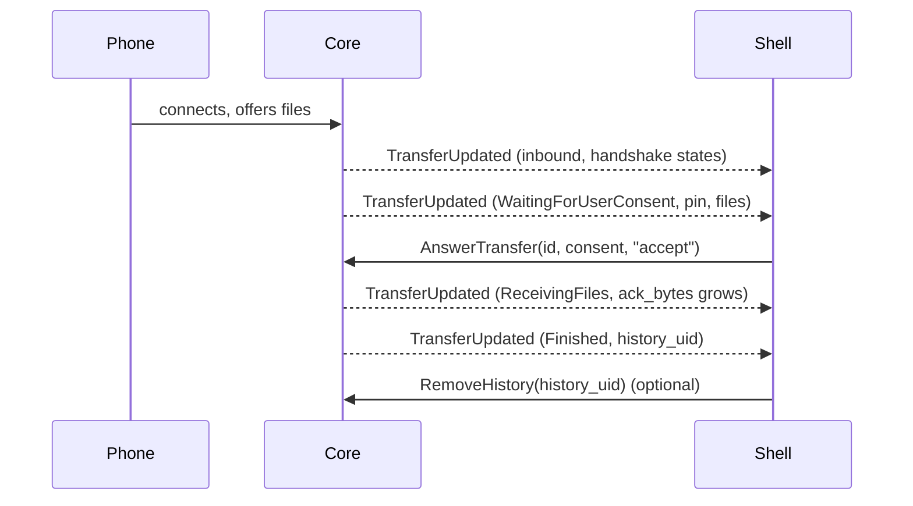

# Core D-Bus API

The core daemon `kuickshared` exposes everything the shell does through one object on the session bus. Any other client can use it the same way. Design and security model: [architecture.md](architecture.md). End-user guide: [usage.md](usage.md).

Contents: [Trying it](#trying-it) · [Methods](#methods) · [Properties](#properties) · [Signals](#signals) ([TransferUpdated](#transferupdated), [DeviceFound](#devicefound)) · [Answer errors](#answer-errors) · [Transfer states](#transfer-states) · [JSON results](#json-results) ([History](#history), [Paired computers](#paired-computers), [Always-accepted devices](#always-accepted-devices)) · [Behaviour](#behaviour) ([Pairing and the trust port](#pairing-and-the-trust-port)) · [How the shell uses it](#how-the-shell-uses-it) · [Guaranteed by tests](#guaranteed-by-tests)

| | |
|---|---|
| Bus name | `io.github.the_beper.KuickShare` (session bus) |
| Object path | `/io/github/the_beper/KuickShare` |
| Interface | `io.github.the_beper.KuickShare1` |

Errors are `org.freedesktop.DBus.Error.Failed` with a human-readable message, unless stated otherwise. Methods that start work (`SendFiles`, `PairWith`, ...) return when the work is queued; the outcome arrives as signals.

## Trying it

Against a running core (the shell starts it, or run `kuickshared`):

```sh
D="--dest io.github.the_beper.KuickShare --object-path /io/github/the_beper/KuickShare"
I=io.github.the_beper.KuickShare1

gdbus introspect --session $D
gdbus call --session $D --method $I.History
gdbus call --session $D --method $I.StartDiscovery
gdbus monitor --session --dest io.github.the_beper.KuickShare   # signals

busctl --user get-property io.github.the_beper.KuickShare /io/github/the_beper/KuickShare $I Visible
busctl --user set-property io.github.the_beper.KuickShare /io/github/the_beper/KuickShare $I DeviceName s "Desk"
```

On a private bus, so the desktop session and the real settings stay untouched (this is what `tests/core/dbus_api.rs` does):

```sh
T=$(mktemp -d); mkdir -p "$T/config" "$T/data"
ADDR=unix:abstract=kuickshare-dev
cat > "$T/bus.conf" <<EOF
<busconfig><type>session</type><listen>$ADDR</listen><auth>EXTERNAL</auth>
<policy context="default"><allow send_destination="*" eavesdrop="true"/>
<allow eavesdrop="true"/><allow own="*"/></policy></busconfig>
EOF
dbus-daemon --config-file="$T/bus.conf" --nofork &

DBUS_SESSION_BUS_ADDRESS=$ADDR HOME=$T XDG_CONFIG_HOME=$T/config XDG_DATA_HOME=$T/data \
    cargo run --bin kuickshared &

gdbus call --address $ADDR --dest io.github.the_beper.KuickShare \
    --object-path /io/github/the_beper/KuickShare --method io.github.the_beper.KuickShare1.History
```

The private bus isolates D-Bus and files only: the daemon still advertises on the LAN through mDNS and listens on the trust port (see [Pairing](#pairing-and-the-trust-port)). The commands above were not run as written (unverified).

## Methods

IDs: a transfer `id` and a device `id` are both taken from `TransferUpdated` and `DeviceFound`.

| Id | Meaning |
|---|---|
| `ip:port` | A device on the network, or a transfer with it |
| `ble:<endpoint id>` (e.g. `ble:G483`) | A phone found over Bluetooth LE (`medium` `ble`); an outgoing transfer to it has the same id. Hex (`ble:0001ff41`) when the 4-byte endpoint id is not printable |
| `ble-<N>` | An incoming Bluetooth transfer; never a device id |

Bluetooth devices are listed only while `WifiUpgrade` is on, can be sent to but not paired with.

| Method | Signature | Description | Errors |
|---|---|---|---|
| `AnswerTransfer` | `(s id, t consent, s answer)` | Answer an incoming transfer waiting for consent. `consent` is the `consent` key of the latest `TransferUpdated` of that transfer (see [TransferUpdated](#transferupdated)); `answer` is `accept`, `accept_and_trust` or `decline`. `accept_and_trust` accepts and adds the sender to the [always-accepted list](#always-accepted-devices), bound to the MAC address read when the prompt opened. The consent is answered once: of several answers that race, one wins | The [answer errors](#answer-errors); an unknown `answer` word gives `InvalidArgs` |
| `Accept` | `(s id)` | Legacy form of `AnswerTransfer` with `accept`, without the token: it cannot tell a reused id from the original, so prefer `AnswerTransfer` | The [answer errors](#answer-errors) except `StaleToken` |
| `Decline` | `(s id)` | Legacy form with `decline` | The same |
| `Cancel` | `(s id)` | Cancel a running transfer, either direction | Service not running |
| `JoinNetwork` | `(s transfer_id)` | Join the Wi-Fi network received in a finished inbound transfer (`payload_kind` `WiFi`). Needs NetworkManager. The core keeps the password only in memory ([architecture.md](architecture.md#wi-fi-credentials-from-a-phone)); it is never on the bus. The network becomes a saved connection that reconnects by itself, and replaces the current Wi-Fi connection of the one Wi-Fi device. WPA/WPA2 and open networks only. On success the credentials are forgotten | Unknown, expired (10 minutes) or already used `transfer_id`; WEP or unknown security type; a transfer is in progress; a Wi-Fi upgrade is running; no Wi-Fi device; the SSID starts with `kuickshare-`; the key is a 64-hex PSK (only 8 to 63 character passphrases are accepted); NetworkManager failed or did not connect within 15 s (the profile is removed and the previous connection restored). Messages never contain the password. The join runs to the end even if the caller goes away. Like `Accept`, any process of the same user on the session bus can call it for a transfer id that has stored credentials. A transfer started during the join (up to about 15 s) can lose its connection. If the SSID already has a NetworkManager profile, a second one is added (existing profiles are not looked up) |
| `StartDiscovery` | `()` | Start looking for nearby devices; reported by `DeviceFound` / `DeviceLost`. Does nothing if already on | Service not running |
| `FirewallManaged` | `() -> b` | Whether firewalld is running on the system bus. When it is not, the core cannot open the one port of the hotspot and refuses the hotspot (`WifiUpgradeBlocked`, `firewall_missing`) unless the session consent was given; the shell asks before turning the setting on when this is `false`. It says nothing about whether firewalld will accept the change (polkit) | none |
| `RequestWifiUpgrade` | `(b enabled, b allow_insecure_hotspot)` | The one call that sets `WifiUpgrade` together with the firewall consent. `enabled` is saved. `allow_insecure_hotspot` lets the computer's hotspot use an open firewall zone when its port cannot be opened (firewalld refused: `trusted` zone; firewalld missing: the zone is left to NetworkManager, so another firewall may still block the phone), for this session only: it is kept in memory and shown by `InsecureHotspotAllowed`. Any other write to the upgrade takes it back: this call with `false`, a write of the `WifiUpgrade` property, `ResetSettings`, a restart of the daemon. Taking it back also takes down a hotspot that runs in an open zone (the transfer goes on over its first channel) | `InvalidArgs` for `(false, true)` (consent without the upgrade), nothing changed |
| `ScanBluetooth` | `()` | Run one more Bluetooth LE scan window (a few seconds) for phones in Receive mode; results arrive as `DeviceFound`. The scan starts at once, then LAN devices that fail two TCP connection attempts of 1.5 s each are dropped (`DeviceLost`) before the call returns, so it can take about 3 s. Nothing is scanned or dropped when discovery is not running. Does nothing without `WifiUpgrade`, a Bluetooth adapter, while a scan or Bluetooth send runs, or within 4 seconds of the previous window | Service not running; discovery is not running |
| `StopDiscovery` | `()` | Stop looking and forget the devices found so far, so sending to one needs a new `StartDiscovery` | none |
| `SendFiles` | `(s device_id, as paths)` | Send files to a discovered device. A Bluetooth device is scanned for again first (up to 12 seconds) | Empty list; a path that cannot be read; unknown device; Bluetooth device while `WifiUpgrade` is off; service stopped |
| `SendText` | `(s device_id, s text, s kind)` | Send text. `kind` `"url"` sends a link, any other value sends plain text | Blank text; unknown device; Bluetooth device while `WifiUpgrade` is off; service stopped |
| `History` | `() -> s` | Finished transfers, newest first, JSON (see [History](#history)). Applies the retention first | none |
| `HistorySize` | `() -> t` | Size of the history file in bytes (0 if never written) | none |
| `RemoveHistory` | `(t uid)` | Delete one entry; an unknown `uid` is ignored | none |
| `ClearHistory` | `()` | Delete all entries | none |
| `SetPairing` | `(b open)` | Let other KuickShare computers start a pairing with this one. `true` opens a 5 minute window, `false` closes it | none |
| `PairWith` | `(s device_id)` | Start pairing with a discovered computer; progress arrives as `PairingCode` / `PairingFinished` | Unknown device; a `ble:` id |
| `ConfirmPairing` | `(b accept)` | Answer to `PairingCode`: do both screens show the same code? Ignored if no pairing waits | none |
| `Unpair` | `(s fingerprint)` | Forget a paired computer and void its announced intent that was not used yet; emits `TrustedChanged` even if the fingerprint is unknown | none |
| `TrustedDevices` | `() -> s` | Paired computers, JSON (see [Paired computers](#paired-computers)) | none |
| `AllowDevice` | `(s transfer_id)` | Legacy: add the sender of an incoming transfer to the always-accepted list, with the MAC address read when its prompt opened. Works only while the transfer waits for an answer, or within 30 s after the user accepted it (an automatic accept does not count). Prefer `AnswerTransfer` with `accept_and_trust`, which cannot race with the accept | Transfer not waiting or not recently accepted by the user, outbound or finished; sender without a name; no MAC address read at open (not in the kernel ARP table, other network, IPv6, Bluetooth) or the address now has another MAC; time to answer over (all `Failed`, with the reason as message) |
| `AcknowledgeTrustedDevicesReset` | `()` | The user saw the notice of `TrustedDevicesReset`: the property becomes `false` and the settings are saved | none |
| `ForgetAllowed` | `(s name, s mac)` | Remove an entry from the list; unknown entries are ignored | none |
| `AllowedDevices` | `() -> s` | Always-accepted devices, JSON (see [Always-accepted devices](#always-accepted-devices)) | none |
| `MakeVisibleFor` | `(u seconds)` | Be visible for `seconds` even when `Visible` is false (capped at 24 h; 0 cancels). Not persisted; setting `Visible`, `ResetSettings` or a core restart ends it. `VisibleUntil` reports the end. The window keeps running while `Suspended` (the computer stays hidden) | none |
| `ResetSettings` | `()` | Put every persisted property back to its default and restart sharing. This also takes back the firewall consent (`InsecureHotspotAllowed` becomes `false`). The always-accepted list and the `TrustedDevicesReset` notice are kept; `Suspended` is not touched | A transfer is in progress; restart failed (settings are put back) |

`Cancel` only fails when the service is not running; an unknown or already finished `id` is not reported as an error (inferred from the code, which has no check for it).

### Answer errors

`AnswerTransfer`, `Accept` and `Decline` fail with these errors, named `io.github.the_beper.KuickShare1.Error.<Name>`; the message is human-readable.

| Name | Meaning | Does the transfer still wait? |
|---|---|---|
| `NotWaiting` | No transfer waits for `id`: unknown, already answered, moved on, or gone | no |
| `Expired` | The time to answer is over; an accept this late declines the transfer | no |
| `StaleToken` | `consent` is not the one of the transfer that waits: the id was reused by a newer transfer, which the stale prompt must not answer | the newer one does |
| `DeviceChanged` | `accept_and_trust` only: the address of the sender now belongs to another MAC address | yes |
| `NoMac` | `accept_and_trust` only: no MAC address was read when the prompt opened (other network, IPv6, Bluetooth), or it cannot be read now | yes |
| `NoName` | `accept_and_trust` only: the sender has no name | yes |
| `NotRunning` | The Quick Share service is stopped | no |
| `InvalidArgs` | `AnswerTransfer` only: `answer` is none of the three words | not applicable |

After the last three, the user can still accept without trusting.

The `consent` value is a guard against stale prompts, not a secret: every client on the session bus can read it from `TransferUpdated` and can call `Accept` without it ([architecture.md](architecture.md#consent-and-the-guard)).

## Properties

All properties are read-write except `VisibleUntil`, `InsecureHotspotAllowed` and `TrustedDevicesReset`. Persisted ones are saved to `~/.config/kuickshare/settings.json` (JSON keys in snake case, e.g. `history_keep_days`); a partial or missing file falls back to the defaults, an unparsable one is moved to `settings.json.bak`.

| Property | Type | Default | Persisted | Effect and errors |
|---|---|---|---|---|
| `DeviceName` | `s` | machine hostname (`Unknown device` if unreadable) | yes | Name shown to other devices. Trimmed and cut to 64 bytes (at a character boundary); empty restores the default. Restarts sharing; fails during a transfer. A value equal to the current one does nothing |
| `DownloadDir` | `s` | `""` (the library default, the XDG download directory) | yes | Trimmed; created if missing (fails if it cannot be). Applied immediately, no restart |
| `StaticPort` | `u` | `0` (random port at each start) | yes | `0` or 1024-65535, else an error. Restarts sharing; fails during a transfer, or if the port cannot be bound (settings go back to the previous value) |
| `Visible` | `b` | `true` | yes | Visible to nearby devices. The effective state is `(Visible or a temporary visibility) and not Suspended` |
| `VisibleUntil` | `x` | `0` | no | Unix seconds when the temporary visibility from `MakeVisibleFor` ends; `0` when none is active. Read-only, not persisted. The window keeps running while `Suspended` |
| `Suspended` | `b` | `false` | no | Hides the computer without changing `Visible`. The shell sets it while Do Not Disturb is on |
| `HideWhenDnd` | `b` | `true` | yes | Stored only; the shell reads it and sets `Suspended` |
| `HistoryEnabled` | `b` | `true` | yes | Off: new transfers are not recorded (`history_uid` stays 0); entries already saved stay |
| `HistoryKeepDays` | `u` | `0` (keep for ever) | yes | Entries older than this are deleted, immediately and each time the history is read or written |
| `TrayIcon` | `b` | `true` | yes | Stored only; the shell shows or hides its tray icon |
| `DolphinIntegration` | `b` | `true` | yes | Stored only; the shell adds or removes the Dolphin entry |
| `TrustedDevicesEnabled` | `b` | `true` | yes | Whether the [always-accepted list](#always-accepted-devices) is honoured |
| `WifiUpgrade` | `b` | `false` | yes | Let transfers move to a temporary Wi-Fi hotspot (see [Wi-Fi upgrade](wifi-direct.md)); needs NetworkManager. A write here is the legacy form of `RequestWifiUpgrade(enabled, false)`: it never grants the firewall consent and takes back any given, so the hotspot is refused when the firewall cannot open its port |
| `InsecureHotspotAllowed` | `b` | `false` | no | Read-only. The user allowed the hotspot an open firewall zone for this session (see `RequestWifiUpgrade`). Never saved: `false` after every start, and after `ResetSettings` or any write to the upgrade without the consent |
| `TrustedDevicesReset` | `b` | `false` | yes | Read-only. `true` from the start after an upgrade that deleted the trusted devices of an older version (once, only if there were any: they were recognised by name and address alone, which can be copied), until `AcknowledgeTrustedDevicesReset`. Kept in `settings.json`, so a restart before the user saw the notice does not lose it |

`ResetSettings` emits `PropertiesChanged` for every property it resets *(not run against a real client)*.

## Signals

| Signal | Signature | Emitted when |
|---|---|---|
| `TransferUpdated` | `(s id, a{sv} info)` | Every event of a transfer, in both directions; see [TransferUpdated](#transferupdated) |
| `DeviceFound` | `(s id, a{sv} info)` | A device is announced or announced again, and once more when the KuickShare check finishes; see [DeviceFound](#devicefound) |
| `DeviceLost` | `(s id)` | A device has not been seen for 4 seconds after it disappeared (for Bluetooth: after a scan window no longer saw it). Android changes its announced name every few seconds, so this grace period hides the lost/found flicker. Also sent at once for a LAN entry replaced by a new announcement with the same address, name and type (a restarted app), and by `ScanBluetooth` for an entry that no longer answers |
| `PairingCode` | `(s code, s peer)` | A pairing needs confirmation. `code` is 8 digits formatted `1234 5678`, derived from the handshake; compare it with the other screen, then call `ConfirmPairing` |
| `PairingFinished` | `(b ok, s peer, s message)` | A pairing ended. `message` is empty on success |
| `TrustedChanged` | `()` | The paired computers list changed (pairing completed or `Unpair`) |
| `WifiUpgradeBlocked` | `(s reason)` | The firewall did not allow the computer's hotspot, so the transfer stays on its first channel (Bluetooth, very slow). `reason`: `firewall_denied` (firewalld is running but refused to open the port, or failed in another way) or `firewall_missing` (firewalld is not running or not reachable). More codes may be added, so treat an unknown one as a refusal. Not emitted when the session consent let the hotspot start in an open zone. The shell offers that consent in a box ([wifi-direct.md](wifi-direct.md#requirements)) |

A restart of sharing (name, port, reset) forgets the discovered devices without emitting `DeviceLost`; discovery continues if it was on.

### TransferUpdated

`info` is a fixed set of 16 keys. Later events of the same transfer often carry less than earlier ones (no device, no file names, zero sizes), so clients should keep the last non-empty value of each key.

| Key | Type | Meaning |
|---|---|---|
| `kind` | `s` | `inbound` or `outbound` |
| `state` | `s` | Library state name, see [Transfer states](#transfer-states); may be empty |
| `device` | `s` | Name of the other device; empty if not known yet |
| `pin` | `s` | Quick Share PIN to compare on both devices; empty if none |
| `preview` | `s` | Short description of the payload as the library gives it |
| `total_bytes` | `t` | Total size |
| `ack_bytes` | `t` | Bytes transferred so far |
| `payload_kind` | `s` | `Files`, `Text`, `Url` or `WiFi`; empty if not known yet |
| `files` | `s` | File names (inbound) or paths, one per line; empty for text |
| `saved_paths` | `s` | Inbound files: where each one was saved (after any `name (1).ext` renaming), one path per line; empty otherwise |
| `text` | `s` | Text or link; for `WiFi`, only the network name, never the password |
| `trusted` | `s` | Set when the transfer was accepted without asking: the paired computer's name, or the device name for an always-accepted device. Empty otherwise |
| `always_accepted` | `s` | Device name when the sender is on the always-accepted list; empty for a paired computer |
| `history_uid` | `t` | `uid` of the history entry written when the transfer ended; 0 on every other event and when the history is off |
| `consent` | `t` | Token of the consent that waits for an answer: the `consent` argument of `AnswerTransfer`. Non-zero while an inbound transfer is in `WaitingForUserConsent` and nobody has answered it; 0 otherwise, also when it was accepted automatically. A new transfer under a reused id gets a new token, so a prompt of the old one cannot answer it. Not a secret (see [Answer errors](#answer-errors)). Unlike the other keys, do not keep an older non-zero value: the latest event decides |
| `reason` | `s` | Why the library refused an incoming offer, empty otherwise; see [Refusal reasons](#refusal-reasons) |

#### Refusal reasons

The library checks an offer before the user is asked and refuses it with a reason; the sender is told with a protocol status (`UnsupportedAttachmentType` or `NotEnoughSpace`), the transfer ends and the codes below reach `reason`. More codes may be added. The limits are in [architecture.md](architecture.md#receive-limits).

| `reason` | Refused because |
|---|---|
| `bad_name` | A file name that cannot be saved as is (empty, `.`, `..`, over 255 bytes, `/`, `\`, control or invisible characters) |
| `too_many_files` | More files in one offer than the limit; the offer is refused whole, never cut short |
| `bad_size` | A negative declared size, or sizes whose sum overflows |
| `duplicate_id` | Two files with the same payload id |
| `not_enough_space` | The declared total plus the reserve does not fit in the free space of the download folder |
| `destination` | The download folder cannot be used: missing, not writable, or replaced since the offer |

### DeviceFound

`info` has 7 keys: six strings and the boolean `pairing`. The same device is usually reported twice: first as announced, then again after the core has checked whether it runs KuickShare.

| Key | Meaning |
|---|---|
| `name` | Advertised name |
| `ip` | Address; empty for Bluetooth |
| `port` | Quick Share port; empty for Bluetooth |
| `device_type` | `Unknown`, `Phone`, `Tablet` or `Laptop`; empty if not announced |
| `medium` | `lan` (mDNS) or `ble` (Bluetooth LE) |
| `trust` | `""` other device, `kuickshare` runs KuickShare, `trusted` paired with this computer (both sides). Only addresses on the local network (private, link-local, loopback, IPv6 ULA) are checked, each at most once every 20 seconds (the computers already known as KuickShare every 4 seconds while this computer's pairing window is open) |
| `pairing` | Boolean: the other computer runs KuickShare and has its pairing window open. `false` for other devices and until the first check; `true` for a KuickShare computer whose version does not report it (the pairing attempt then says whether it was refused) |

## Transfer states

`state` is the library's state name. The states that end a transfer:

| State | Final | Meaning |
|---|---|---|
| `Finished` | yes | Completed. For received files only after every file has its declared size and was synced; a file that is not complete is removed instead |
| `Cancelled` | yes | Cancelled by either side |
| `Rejected` | yes | Declined |
| `Disconnected` | yes | Connection lost |
| `WaitingForUserConsent` | no | Inbound transfer waits for `AnswerTransfer` (or `Accept` / `Decline`); `consent` is non-zero |
| `ReceivingFiles`, `SendingFiles` | no | Data is moving |
| `Initial`, `ReceivedConnectionRequest`, `SentUkeyServerInit`, `SentUkeyClientInit`, `SentUkeyClientFinish`, `SentPairedKeyEncryption`, `ReceivedUkeyClientFinish`, `SentConnectionResponse`, `SentPairedKeyResult`, `SentIntroduction`, `ReceivedPairedKeyResult` | no | Handshake steps of the protocol |

The library itself emits `Disconnected` for a send that fails before the transfer starts *(inferred from the library code, not reproduced)*. If a send hangs and no event comes for 40 seconds (`BLE_START_TIMEOUT`, `LAN_START_TIMEOUT` in `src/core/app.rs`), the core emits `Disconnected` for that id (outbound, no history entry).

Only the first final state of a transfer is recorded in the history. `Finished` can be followed by `Disconnected`; that second event has `history_uid` 0.



## JSON results

### History

`History()` returns an array, newest first. The file is `~/.local/share/kuickshare/history.json`.

```json
[{"uid":1760795000123,"time":1760795000,"kind":"inbound","state":"Finished","device":"Pixel","payload_kind":"Files","files":["a.jpg"],"text":"","total_bytes":482113,"trusted":false}]
```

| Field | Type | Meaning |
|---|---|---|
| `uid` | number | Identifier: Unix time in milliseconds, made unique. Entries saved before it existed get one derived from `time` |
| `time` | number | Unix time in seconds when the transfer ended |
| `kind` | string | `inbound` or `outbound` |
| `state` | string | Final state: `Finished`, `Cancelled`, `Rejected` or `Disconnected` |
| `device` | string | Name of the other device |
| `payload_kind` | string | `Files`, `Text`, `Url`, `WiFi` or empty |
| `files` | array of strings | At most 200 names kept |
| `text` | string | Text or link (at most 10 000 characters kept), or the Wi-Fi network name |
| `total_bytes` | number | Size |
| `trusted` | boolean | Accepted without asking (paired computer or always-accepted device) |

### Paired computers

`TrustedDevices()`; stored in `~/.local/share/kuickshare/peers.json`.

```json
[{"name":"desk","fingerprint":"9f2c...","public_key":"04ab...","paired_at":1760795000}]
```

| Field | Type | Meaning |
|---|---|---|
| `name` | string | Name the other computer had when pairing |
| `fingerprint` | string | SHA-256 of the public key, hex; the argument of `Unpair` |
| `public_key` | string | Hex |
| `paired_at` | number | Unix time in seconds |

### Always-accepted devices

`AllowedDevices()`; stored in `settings.json` as `allowed_devices`.

```json
[{"name":"Pixel","mac":"aa:bb:cc:dd:ee:01"}]
```

| Field | Type | Meaning |
|---|---|---|
| `name` | string | Advertised device name |
| `mac` | string | Lowercase, colon separated; read from `/proc/net/arp` |

An incoming transfer is accepted without asking only if `TrustedDevicesEnabled` is on and both the advertised name and the MAC the kernel has for the sender's address, read once when the prompt opened, match an entry. A different MAC, an unknown MAC (other network, IPv6) or an empty name means the user is asked as usual. No signal is emitted when the list changes. Name and MAC can be copied by anyone on the same network ([architecture.md](architecture.md#trusted-devices-by-name-and-mac)); the lists of older versions were deleted once for that reason (`TrustedDevicesReset`).

## Behaviour

| Topic | Behaviour |
|---|---|
| Consent | Every way of answering an incoming transfer (`AnswerTransfer`, `Accept`, `Decline`, the automatic accepts, the timeout) goes through one book in the core; each consent has a token, a deadline, and the name, address and MAC address seen when it opened, and is answered once. A transfer nobody answers is declined ([consent timeout](architecture.md#consent-and-the-guard)); too many waiting at once (in all, from one address, or over the network) are declined at once |
| Unsafe file names | An inbound transfer with an empty name, `.`, `..`, a name over 255 bytes, or a name with `/`, `\`, control characters or invisible text-direction characters is declined before anything can accept it, whatever the trust rules say; the zero-width joiners U+200C and U+200D are allowed. The core and the library apply the same rule. No error reaches the caller; the transfer ends like a decline |
| Offers the library refuses | More than the allowed files, bad sizes, not enough free space and the like are refused before the user is asked; `reason` says why ([Refusal reasons](#refusal-reasons)) |
| Unpair | A paired computer's announced intent, not yet used, is void after `Unpair` |
| Settings that restart sharing | `DeviceName`, `StaticPort` and `ResetSettings` stop and rebuild the service; discovered devices are forgotten, discovery resumes if it was on. They fail with `Wait for the current transfer to finish before changing this setting` while a transfer is in flight |
| Stale transfers | A transfer with no event for 600 seconds counts as over when checking the previous point, so a lost final event cannot block those settings for ever. Such a transfer never reaches the history |
| Failed restart | The previous settings are restored and the service is started again with them |
| History limits | 200 file names and 10 000 text characters per entry; the newest 1000 entries; entries older than `HistoryKeepDays` days are removed when the history is read, written, or the property changes |
| Automatic acceptance | Paired computers (announced over the trust port) and always-accepted devices are accepted by the core itself, through the same consent book, and the event carries `trusted` |

### Pairing and the trust port

Pairing and paired-computer checks use a separate fixed TCP port (see [architecture.md](architecture.md#paired-computers)), Noise XX channel. If it cannot be bound, the core logs a warning and keeps working without paired computers.

| Rule | Value |
|---|---|
| One pairing at a time | A second attempt while one is waiting is refused with `Another pairing is in progress` and no `PairingFinished` is emitted for it |
| Code confirmation | `Nobody confirmed the code in time` when the time runs out |
| Pairing window | Opened by `SetPairing(true)`; the other computer must also have a non-empty name |
| Times and limits | See [Limits on the trust port](architecture.md#limits-on-the-trust-port) |

## How the shell uses it

`src/shell/corebridge.cpp` starts `kuickshared`, watches the bus name for owner changes, reads all properties and the three JSON lists when the core appears, and subscribes to all seven signals. It answers prompts with `AnswerTransfer` and the `consent` of the latest event of the transfer (a token of 0 is refused without asking the core), closes a prompt when the core says `NotWaiting`, `Expired` or `StaleToken`, keeps it when the sender cannot be trusted (it then offers no "Accept and trust"), shows the `reason` of a refused offer in a notification, shows the `TrustedDevicesReset` notice until `AcknowledgeTrustedDevicesReset`, and shows a box on `WifiUpgradeBlocked` that offers the session consent through `RequestWifiUpgrade`. It reloads the paired computers on `TrustedChanged`, calls `HistorySize` after a transfer ends to warn about a big history, sets `Suspended` from Do Not Disturb, and stops discovery 30 seconds after the Send page is left.

## Guaranteed by tests

`tests/core/dbus_api.rs` runs the daemon on a private bus and checks:

- default values of `Visible`, `HistoryEnabled`, `TrayIcon`, `DolphinIntegration`, `TrustedDevicesEnabled`, `WifiUpgrade`, `HistoryKeepDays`, and that `History` and `AllowedDevices` start as `[]`
- history and integration properties take effect and are written to `settings.json`
- `ResetSettings` restores defaults, including a renamed device and `Visible`
- history retention removes old entries from the answer and from the file; `HistorySize`, `RemoveHistory` and `ClearHistory` work; entries without `uid` get one
- `AllowDevice` fails for an unknown transfer and `ForgetAllowed` accepts an unknown entry
- `JoinNetwork` fails for a transfer id without stored credentials

`ScanBluetooth` and the refusal of `ble:` ids for pairing and sending are checked, but the tests cannot do Bluetooth. Transfers, discovery and pairing are not exercised through D-Bus by these tests; pairing has loopback tests in `src/core/trust.rs`.
