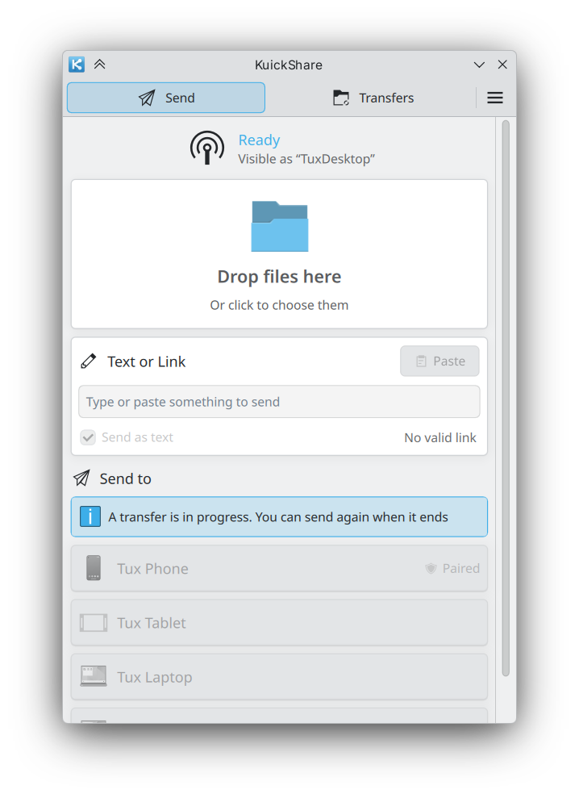
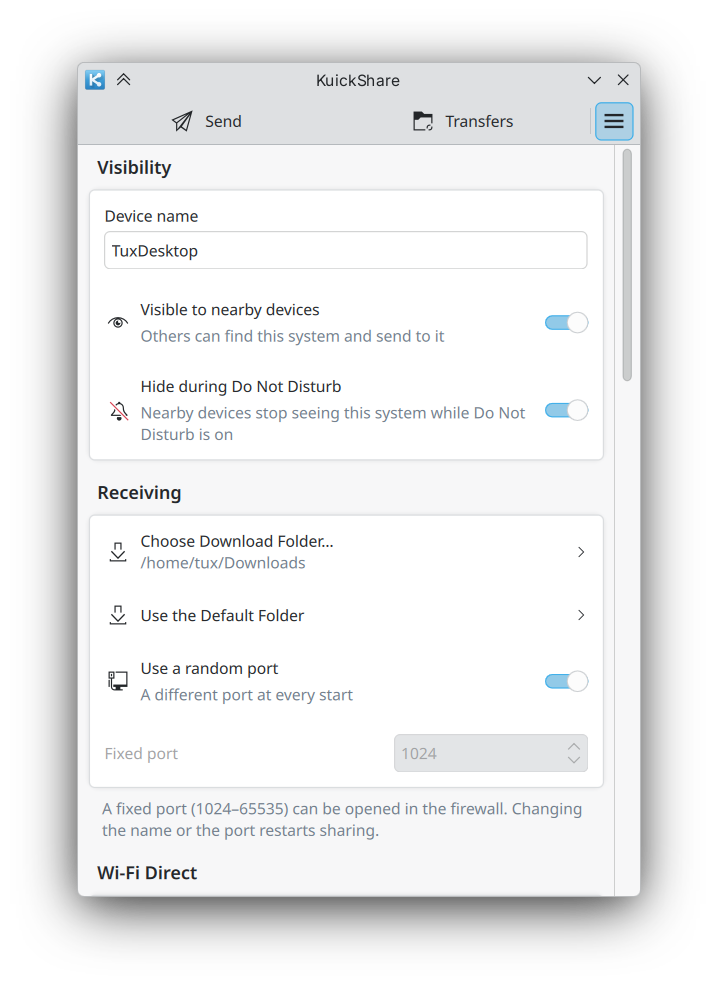

# KuickShare user guide

KuickShare sends and receives files, text and links with Android phones through Google's Quick Share, from a KDE Plasma 6 desktop. This guide covers installation, daily use, every preference and troubleshooting. For how it works inside, see [architecture.md](architecture.md); for the D-Bus interface of the background service, see [dbus-api.md](dbus-api.md).

KuickShare has two programs. `kuickshare` is the window, tray icon and notifications. `kuickshared` is the background service that speaks the Quick Share protocol; the window starts it and stops it.

## In this guide

- Setup: [Requirements](#requirements), [Installing, updating and uninstalling](#installing-updating-and-uninstalling), [First run](#first-run)
- Daily use: [Sending](#sending), [Receiving](#receiving), [Without a shared network](#without-a-shared-network-experimental), [Transfers page and history](#transfers-page-and-history)
- Devices: [Paired devices](#paired-devices), [Trusted devices](#trusted-devices)
- Reference: [Preferences](#preferences), [Do Not Disturb](#do-not-disturb), [Keyboard shortcuts](#keyboard-shortcuts), [Troubleshooting](#troubleshooting), [Where things are stored](#where-things-are-stored)

## Requirements

- KDE Plasma 6. The AppImage and the Flatpak bring their own libraries (the Flatpak needs Flatpak and [Flathub](https://flathub.org/setup)). The tarball uses the system's Qt 6 (6.9 or newer) and KDE Frameworks 6: on Fedora, `kf6-kirigami`, `kf6-kirigami-addons` and `qt6-qtdeclarative`. The installer checks for them and prints the `dnf install` (or `pacman`) line if one is missing.
- The computer and the phone on the same Wi-Fi network. Bluetooth finds devices and carries data only with the experimental [Wi-Fi upgrade](wifi-direct.md) on (the start of a transfer, slowly, until the Wi-Fi link takes over). Without a shared network, enable that upgrade.
- A Google account is not needed and cannot be used.

## Installing, updating and uninstalling

### Flatpak

```sh
flatpak remote-add --user --if-not-exists kuickshare https://the-beper.github.io/KuickShare/kuickshare.flatpakrepo
flatpak install --user kuickshare io.github.the_beper.KuickShare
```

The software center can add the repository from the same `.flatpakrepo` file. Updates come with `flatpak update` or the software center. A `.flatpak` bundle is also attached to each release (`flatpak install --user KuickShare-x86_64.flatpak`).

| Command | Effect |
|---|---|
| `flatpak run io.github.the_beper.KuickShare` | Start the app (also in the application menu) |
| `flatpak uninstall io.github.the_beper.KuickShare` | Remove the program |
| `flatpak uninstall --delete-data io.github.the_beper.KuickShare` | Also delete settings, history, paired devices and the identity key (`~/.var/app/io.github.the_beper.KuickShare`) |

The sandbox is deliberately open where the integration needs it:

| Permission | Why |
|---|---|
| Network | Quick Share and the pairing port |
| `org.bluez` (system bus) and Bluetooth sockets | Finding devices over Bluetooth, and the Bluetooth channel of a send |
| `org.freedesktop.NetworkManager`, `org.fedoraproject.FirewallD1` (system bus) | The [Wi-Fi upgrade](wifi-direct.md) (off unless enabled) |
| `org.freedesktop.PolicyKit1` (system bus) | The [requirements check](#checking-the-requirements) asks, without a prompt, whether firewalld will let you open the hotspot port. The grant reaches all of polkit's interface, not only that call *(inferred: authorization checks for any action, also with a prompt, and registering an authentication agent)*, so it is a deliberate widening |
| `org.kde.kuickshare` (own name) | Single-instance service of the window |
| `org.kde.JobViewServer`, `org.freedesktop.Notifications`, `org.kde.StatusNotifierWatcher` | Job progress, Do Not Disturb, tray icon |
| Downloads folder | Received files. Another download folder is refused with a message until you grant it: `flatpak override --user --filesystem=/path io.github.the_beper.KuickShare` |
| `~/.local/share/kio/servicemenus` and `~/.config/autostart` (create) | The app writes the Dolphin entry and the autostart entry there, since Flatpak cannot export them |

The Dolphin and autostart entries:

- Both start the app through `flatpak run`.
- The app finds the host folders from where Flatpak mounts the two granted ones, so a custom `XDG_DATA_HOME` or `XDG_CONFIG_HOME` works (tested in a container). Without such a mount it falls back to `~/.local/share` and `~/.config`.
- The AppImage and the Flatpak write the same Dolphin entry file, so install only one.
- Uninstalling the Flatpak leaves both behind: remove `kuickshare-send.desktop` and `io.github.the_beper.KuickShare.desktop` from those folders.

Files sent from Dolphin, the file chooser or by drag and drop reach the sandbox through the document portal. The hand-over of a file from a second launch is tested in a container; the file chooser and Dolphin are unverified on a real desktop.

### AppImage

A normal, self-contained AppImage: it brings its own libraries and runs on any distribution, including NixOS and musl ones. Running it starts KuickShare and installs nothing. The latest release is always at `https://github.com/the-beper/KuickShare/releases/latest/download/KuickShare-x86_64.AppImage`.

```sh
chmod +x KuickShare-x86_64.AppImage
./KuickShare-x86_64.AppImage
```

It can be managed with the usual tools ([Gear Lever](https://github.com/mijorus/gearlever), [AM / AppMan](https://github.com/ivan-hc/AM), [soar](https://github.com/pkgforge/soar)) and updates with `appimageupdatetool` or any updater that reads its embedded update information (zsync, GitHub releases).

On the first start an information box at the top of the window asks once "Add KuickShare to the menus?" (application menu and Dolphin's context menu):

| Answer | Effect |
|---|---|
| Add to Menus | Writes the menu entry and the Dolphin entry, both pointing at the AppImage file. If you move the file, turn the Dolphin entry off and on again in Preferences |
| Not Now | Turns the Dolphin entry off in Preferences |

- The Preferences have a "Show in the application menu" switch (AppImage only) that adds or removes the menu entry at any time, so it also works where the question is not asked.
- Nothing is asked if an installation or those entries already exist, if the app starts with `--background`, or if `XDG_CURRENT_DESKTOP` is not set (a bare session such as Xvfb).
- The answer is remembered in `~/.config/kuickshare/integration-asked`.
- To remove the menu entry, delete `~/.local/share/applications/io.github.the_beper.KuickShare.desktop` and the icons it installed.

| Command | Effect |
|---|---|
| `KuickShare-x86_64.AppImage [file...]` | Start the app; the files are queued on the Send page |

To install KuickShare into `~/.local` with the system's libraries instead, use the tarball (below).

### Tarball

For people who want neither the AppImage nor the Flatpak. It holds the program built against the system's Qt 6 and KDE Frameworks 6, and an installer that copies it into `~/.local`; afterwards the extracted folder can be deleted.

```sh
tar xf KuickShare-x86_64.tar.gz
KuickShare-<version>/install.sh
```

| Command | Effect |
|---|---|
| `install.sh [--no-launch] [file...]` | Install or update, then start the app (`--no-launch` only installs; a running instance is still restarted); the files are queued on the Send page |
| `install.sh --uninstall` | Remove the program; settings, history and paired devices stay |
| `install.sh --uninstall --purge` | Also delete settings, history, paired devices and the identity key |
| `~/.local/share/kuickshare/uninstall.sh [--purge]` | The same, without the tarball |

What the tarball installer writes, under `XDG_DATA_HOME` and `XDG_CONFIG_HOME` when set; the table shows the defaults:

| What | Where |
|---|---|
| Programs `kuickshare`, `kuickshared` | `~/.local/share/kuickshare/bin/` |
| Command in the shell path | `~/.local/bin/kuickshare` (a link; an existing file or link of yours is left alone) |
| Installer, uninstaller, version | `~/.local/share/kuickshare/` |
| Menu entry, app metadata | `~/.local/share/applications/`, `~/.local/share/metainfo/` |
| Dolphin "Send With KuickShare" | `~/.local/share/kio/servicemenus/kuickshare-send.desktop` |
| Notification definitions | `~/.local/share/knotifications6/kuickshare.notifyrc` |
| Icons | `~/.local/share/icons/hicolor/` |
| Translations | `~/.local/share/locale/` |
| Autostart entry (only if "Start at login" is on) | `~/.config/autostart/io.github.the_beper.KuickShare.desktop` |

Uninstalling removes all of these except the data listed under [Where things are stored](#where-things-are-stored), which `--purge` removes as well.

### rpm

For Fedora (and rpm distributions it is known to work on): a system package into `/usr`, managed by the rpm database like any other package. The latest release is always at `https://github.com/the-beper/KuickShare/releases/latest/download/KuickShare-x86_64.rpm`.

```sh
sudo dnf install ./KuickShare-x86_64.rpm
```

| Command | Effect |
|---|---|
| `sudo dnf install ./KuickShare-x86_64.rpm` | Install or update (also in the software center, by opening the file) |
| `sudo dnf remove kuickshare` | Remove the program; settings, history and paired devices stay |

The runtime dependencies (Qt 6, KDE Frameworks 6 and their QML modules) come from the distribution's repositories. Uninstalling leaves `~/.config/kuickshare/` (settings, history, paired devices); delete it by hand to purge.

### deb

For Ubuntu 26.04 and newer (apt distributions it is known to work on): a system package into `/usr`, managed by the dpkg database. The latest release is always at `https://github.com/the-beper/KuickShare/releases/latest/download/KuickShare-x86_64.deb`.

```sh
sudo apt install ./KuickShare-x86_64.deb
```

| Command | Effect |
|---|---|
| `sudo apt install ./KuickShare-x86_64.deb` | Install or update (also in the software center, by opening the file) |
| `sudo apt remove kuickshare` | Remove the program; settings, history and paired devices stay |

Uninstalling leaves `~/.config/kuickshare/` (settings, history, paired devices); delete it by hand to purge.

### Arch package

For Arch Linux: a system package into `/usr`, managed by pacman like any other. The latest release is always at `https://github.com/the-beper/KuickShare/releases/latest/download/KuickShare-x86_64.pkg.tar.zst`.

```sh
sudo pacman -U ./KuickShare-x86_64.pkg.tar.zst
```

| Command | Effect |
|---|---|
| `sudo pacman -U ./KuickShare-x86_64.pkg.tar.zst` | Install or update; later updates are manual (this package is not in a repository) |
| `sudo pacman -R kuickshare` | Remove the program; settings, history and paired devices stay |

Uninstalling leaves `~/.config/kuickshare/` (settings, history, paired devices); delete it by hand to purge.

## First run

The window opens on the Send page and a tray icon appears. The computer is visible to nearby devices under the hostname, until you change the name in Preferences.

The window has a fixed size. Closing it hides it in the tray and frees its memory (queued files and the current page are forgotten); the service keeps running, so the computer can still receive. The tray icon opens the window on a left click. Its menu has these entries:

| Entry | Effect |
|---|---|
| Open KuickShare | Show the window |
| Send Files… | Open the file chooser on the Send page |
| Send Clipboard | Add the clipboard to the Send page |
| Visible to Nearby Devices | Same switch as in Preferences |
| Visible for 10 Minutes | Checkable. Visible even when the switch above is off, then back to it. The minutes left are in the tray tooltip; click again to stop |
| Preferences | Open Preferences |
| Quit | Quit at once; if a transfer is running, opens the window to ask first |

The tray item is created when "Keep running in the background" is on (once the service reports the setting) and then stays until the app exits; turning the switch off makes it Passive. Its status is Passive at rest, Active during a transfer or a temporary visibility, and NeedsAttention while an incoming request waits for an answer. Plasma should keep a Passive item among the hidden tray icons and highlight the others; this was not tested on a real Plasma desktop (unverified).

With "Keep running in the background" off, closing the window quits the app. See [Preferences](#preferences).

The tabs are Send and Transfers. The "More" button at their right opens a menu with Preferences, Shortcuts, Help and About. Quit is `Ctrl+Q` or the tray menu.

## Sending



The Send page takes files, or text, or a link. Choose what to send, then click a device in the "Send to" list. While a transfer is running (sending or receiving, not one that only waits for your approval) the devices are greyed out and a note says so; you can still queue files and text, and send when it ends. The status line at the top says whether this computer is ready, hidden or hidden by Do Not Disturb.

On the phone, open Quick Share and set it to receive from **Everyone** first. See [Troubleshooting](#troubleshooting).

Before sending to a device found on the network, KuickShare checks briefly that it answers. If the phone is gone (for example its Wi-Fi went off, which it does not announce), its entry disappears and, with the Wi-Fi upgrade on and exactly one match by name and device type, the send goes over Bluetooth; otherwise it stops with "The device is not reachable". The other way round, a phone listed over Bluetooth that answers on the network is reached over the network. The route rules and timings are in [wifi-direct.md](wifi-direct.md#behaviour). The transfer row keeps the entry you clicked. **Cancel** is available from the moment you press a device ("Looking for the device…", "Connecting…", "Waiting for the other device to accept").

### Files


There are five ways to add files, and they combine:

- Click the drop area, or press `Ctrl+O`, or use **Send files...** in the tray menu.
- Drop files on the drop area, or anywhere on the window. The window accepts a drop on any page and switches to Send.
- Press `Ctrl+V` on the Send page. File paths copied in Dolphin are added as files. An image on the clipboard without text, such as a screenshot, is saved as a PNG in `~/.cache/kuickshare/clipboard/` and added.
- Use **Paste from clipboard** in the drop area, or **Send clipboard** in the tray menu.
- Pass them on the command line, or use the Dolphin entry below.

A folder, dropped, pasted or given on the command line, is flattened: each regular file below it is queued as if chosen on its own and the folder structure is not kept on the receiving side. Hidden files and folders (names starting with `.`) and symbolic links are skipped. A folder that would bring one add past 500 files in total, or has more than 20000 entries, adds none of its files and shows an error; so does a folder with no file to send. The file dialog picks files only. The list shows the first five files and a "Show all" link for the rest. **Clear** empties the list, **Add** adds more.

### Text and links

The "Text or link" box takes up to 100000 characters. A counter appears when the text is within 10% of the limit; pasting and typing stop at the limit and longer text is cut. Spaces and blank lines around the text, and trailing spaces on each line, are removed before sending.

If the whole text is one link of the form `scheme://host.tld...`, it is sent as a link by default. The receiving phone then offers to open it. Tick **Send as text** to send it as plain text instead. A link with any other text around it can only be sent as text, so the box is ticked and locked. Files and text are exclusive: if files are queued, they are sent and the text is not.

`Ctrl+V` outside the text box pastes into the page as described above; inside the text box it pastes text only.

### From Dolphin and the command line

Right-click files in Dolphin and choose **Send With KuickShare**. It is a top-level entry and opens the Send page with the files queued. It can be turned off in Preferences.

```sh
kuickshare [--background] [--page send|transfers|settings|help] [--device <name>] [files...]
```

`kuickshare --help` lists the options. If KuickShare is already running, a second launch hands its files to the running window and shows it. `--page` accepts `send`, `transfers`, `settings` or `help`; the window on the Send page is the default. `--background` starts hidden in the tray, which is what the login entry uses.

`--device <name>` sends the files to the nearby device with that name, without a click: the name is compared whole, ignoring case and surrounding spaces. Discovery runs for up to 30 seconds, and a match must stay the only one for about 3 seconds before the send. On a match the Transfers page opens (with `--background` the app stays in the tray). If no device or several devices have that name, or there are no files (none given and none queued on the Send page), nothing is sent, the files stay queued on the Send page and the window opens to show the error, also with `--background`. If a folder is refused, nothing is sent: the error stays and the other files stay queued. A new `--device` request cancels a pending one, and files added meanwhile by a plain launch are not part of its send.

## Receiving

When a nearby device wants to send, a persistent notification titled "Incoming Transfer" names the sender, shows a PIN if the protocol supplied one, and offers these actions. Requests always notify. The end-of-transfer notifications below are skipped while the window is shown and active, because the in-app toast covers them; error toasts stay until closed and have a Copy action.

| Action | Effect |
|---|---|
| Accept | Receive the transfer |
| Accept and Trust | Accept, and add the sender to the trusted devices (only if trusted devices are on; see [below](#trusted-devices)). It binds the MAC address read when the request arrived; if that cannot be checked (another network, a changed address, no name) the transfer keeps waiting, now with Accept and Decline only |
| Decline | Refuse the transfer |

The same request is also listed on the Transfers page with Accept and Decline buttons. Compare the PIN with the one on the phone before accepting.

A request nobody answers is declined after 5 minutes. A request is answered once: a notification left over from an earlier transfer closes by itself and cannot answer a newer one. If many requests wait at once (32, or 4 from one address) the new ones are declined.

Files go to the download folder, `~/Downloads` unless you chose another one in Preferences. Progress and a cancel button appear in Plasma's job tracker. When it finishes you get a "Files received" notification with **Open folder**. Text arrives as a "Text received" notification with **Copy**, and **Open link** when the text is a single `http://` or `https://` address.

A sender can propose file names that would write outside the download folder. KuickShare declines such a transfer before asking you. A name is refused if it is empty, is `.` or `..`, is longer than 255 bytes, or contains a `/`, a `\`, a control character, or an invisible character such as a zero-width space or a right-to-left override. The decision is logged and no notification is shown; how the Transfers page then shows the row was not checked (unverified).

An offer is also checked before you are asked: more than 10,000 files, impossible sizes, or not enough free space in the download folder (it must fit with 32 MiB to spare) are refused, and an "Offer refused" notification names the reason. Nothing is written before you accept. A file never overwrites an existing one (the new one gets ` (1)`, ` (2)`, … before the extension), and a file that did not arrive complete (cancelled, declined, error, connection lost) is removed. After a crash or a power cut a partial file can stay in the download folder.

**Wi-Fi networks.** When a phone shares a Wi-Fi network, the finished transfer's row shows its name and a **Join network** button. After you confirm, KuickShare connects this computer through NetworkManager and saves the network, so it connects again by itself; the current Wi-Fi connection is replaced. Only WPA/WPA2 (a passphrase, not a 64-hex key) and open networks work, and not names starting with `kuickshare-`. If you already have a connection for that network, a second one is added. The password is never written to disk; it is kept in memory for 10 minutes at most, so the button stops working after that, after the transfer is declined, or when the sharing service restarts (the error says so); rows from earlier sessions have no button. It is refused while another transfer or a Wi-Fi upgrade is running. Not tried against a real NetworkManager or phone *(inferred)*.

Sending to the phone produces the same notifications in the other direction. If the phone declines before any data moved, you see "Transfer not accepted"; a lost connection gives "Transfer interrupted".

## Without a shared network (experimental)

With **Settings → Wi-Fi Direct → Receive and send without a shared network** on, a phone whose Wi-Fi is off or on another network can send to this computer, and this computer can send to it. The transfer starts over Bluetooth and moves to a temporary Wi-Fi link. It is off by default.

| | Receiving | Sending |
|---|---|---|
| Phone | Quick Share open on the share sheet | Quick Share's receive screen open, visibility **Everyone** |
| Computer | Visible; the setting on | The phone appears with a Bluetooth icon on the Send page. The refresh button next to "Send to" scans again (a scan lasts about 15 s and is never continuous) |
| Wi-Fi link | This computer starts a hotspot | The phone starts a Wi-Fi Direct group and this computer joins it |
| Needs | The `dnsmasq` package: NetworkManager runs it to give the phone an address | Nothing extra |

**Requirements and firewall**

- NetworkManager and Bluetooth; no privileges.
- With firewalld the computer opens only the port of the transfer, and closes it afterwards.
- If the port cannot be opened (firewalld is not running, as with ufw, nftables or no firewall, or it refuses), the hotspot is not started and the transfer stays on Bluetooth, which is very slow. A box then says so and offers **Allow for this session…**.
- Turning the setting on while firewalld is not running asks first. If you agree, then until KuickShare is closed the hotspot may run without a rule for its port: with firewalld refusing, the phone that joins can reach every service of this computer; without firewalld, the zone is left to NetworkManager and another firewall may still block the phone. The permission is not saved, and it is taken back when KuickShare restarts, when you reset the preferences, and when you turn the setting off. It applies to the next transfer, not the one in progress.
- A computer with one radio can lose its Wi-Fi connection while the link is up.
- This was not tried with a phone since the firewall rule changed.

### Checking the requirements

Under **Settings → Wi-Fi Direct**, **Check System Requirements…** opens the dialog "Check System Requirements"; it works also when the switch is disabled. Its description sums up the last check: everything is available, only sending or only receiving works, neither works, or some items could not be checked or need attention. Checking only reads: it never changes Bluetooth, Wi-Fi or the firewall. How each requirement is judged, and what is never verified, is in [wifi-direct.md](wifi-direct.md#checking-the-requirements).

The dialog shows:

- The three capabilities (Sending, Receiving, Join network), each Available, Limited, Unavailable or Unknown, and when they were last checked ("out of date" when they are). A plain line says when the service is unavailable or the result could not be read.
- One entry per component: Bluetooth (BlueZ), NetworkManager, Wi-Fi adapter, Hotspot addresses (dnsmasq), Firewall (firewalld) and, in a Flatpak, Flatpak permissions. Each has a status icon and reads "Ready" or a short note (such as "dnsmasq is installed"), or says right under its name what needs attention, what to do and, where useful, a command to copy (it is never run). In a Flatpak dnsmasq cannot be looked for: it reads "Checked when the first hotspot starts" and does not lower Receiving.
- **Refresh** asks the core to check again (it may return a check made a moment ago); opening the dialog checks only when the last result is missing or out of date.
- **Copy diagnostic report** puts plain text on the clipboard for a bug report: shell, core and schema versions, packaging, the check time (UTC), the three capabilities, and one line per item with its id, status, reason code, category and how it was checked. It leaves out the details and device fields and holds no network names (SSIDs), MAC or IP addresses, or device names.

An "Available" result is not a promise: the check cannot tell whether a hotspot will start or the firewall will accept it (see the link above), and nothing here was hand-tested with real services.

When you turn the switch on:

- If neither sending nor receiving can work, the switch is off and cannot be turned on, and **Check System Requirements…** says so. If it was already on, it can still be turned off.
- If only one direction can work, the switch turns on and **Check System Requirements…** says "Only sending works on this computer" or "Only receiving works on this computer".
- If something could not be checked, the switch turns on and **Check System Requirements…** says "Some items could not be checked".

**Visibility**

- While the setting is on, this computer is visible over Bluetooth, under its device name, to devices in range. Nothing is sent without your consent.
- A phone on the same network as the computer is reached over the network and never takes part in the upgrade; it is listed once, even if Bluetooth sees it too.

**Trust and PIN**

- "Accept and Trust" is not offered for Bluetooth transfers.
- A PIN is shown for each one: compare it with the phone.

**Network changes** (need NetworkManager and the setting on)

- When the last network connection drops (for example the Wi-Fi is turned off), the devices found over the network disappear from the Send page at once and a Bluetooth scan starts. A phone still in range shows up with the Bluetooth icon after a few seconds.
- When a network comes back, the search for devices starts over at once, so a phone on it is found without waiting for the periodic check (up to about 30 s).

**Plasma and the job tracker**

- Plasma shows "Connection 'kuickshare-ap' activated" for the temporary link. It cannot be hidden per connection, only for all networks in System Settings → Notifications → Network Management.
- When you press a device on the Send page, the Transfers page gets its row and a job appears in Plasma's job tracker at once. The job names the step, in this order: "Looking for the device…", "Connecting…", "Waiting for the other device to accept", then "Switching to Wi-Fi…" until data moves.
- When it finishes, the Send page is left empty; after a failure the files and text stay for a new attempt.

## Transfers page and history


The Transfers page lists transfers newest first, running ones included. A card shows the device, the state, the size and the date. While a transfer runs, the state line also shows the speed and the time left once there is an estimate. Buttons depend on the state:

| Button | When |
|---|---|
| Accept, Decline | A request is waiting |
| Cancel | A transfer is running |
| Open folder | A received file transfer finished |
| Copy | A text or link was received or sent |
| More details | Always on finished entries: result, size, file names or text. For files received in this session (the saved history does not keep where files went), each file still in the download folder has an **Open** button; executables and launcher files never do |
| Remove from list | Finished entries |

At the top, a search field and two menus narrow the list: the search matches the device name, received text and file names; the menus pick the direction (all, received, sent) and the status (any, in progress, completed, not completed, which covers cancelled, declined and interrupted transfers). The filters are not saved and do not change the history. With no match the page says so; **Reset filters**, next to the menus, brings the whole list back (it is greyed out while no filter is set).

When a transfer ends, a message slides up from the bottom edge of the window, on any page, and stacks above older ones (at most four):

| Message | Colour | Stays |
|---|---|---|
| Transfer completed | Green | 4 s |
| The transfer failed | Red | 10 s |
| The transfer was declined, The transfer was cancelled | Blue | 6 s |

Errors the service reports, and "Copied to clipboard" (green, 1.5 s), use the same messages. A message that stays more than 3 s has a close button.

Entries keep at most 200 file names and 10000 characters of text. Wi-Fi credentials received from a phone are saved without the password; the password is never written to disk (it stays in memory for 10 minutes at most, see [Receiving](#receiving)). **Clear History** deletes the whole list, not only the transfers the filters show, and does not touch received files. A banner suggests clearing when the history file gets large.

The history is saved in a file on disk, 1000 entries at most (the oldest go first). It is controlled in Preferences: it can be turned off, and entries can expire after 1, 7, 30 or 90 days. With the history off, the page only lists transfers made while the app is open.

## Paired devices

Pairing lets two computers running KuickShare send to each other without asking. Phones cannot take part, because the pairing uses a channel of its own on top of Quick Share (see [architecture.md](architecture.md) for the protocol and its limits).


1. On both computers open Preferences and choose **Pair a Device…**.
2. On one of them, click the other computer in the list. Computers already paired are listed as "Already paired" and cannot be chosen.
3. Both screens show the same 8-digit code. Check that it is identical, then click **Confirm Pairing** on both. If it differs, click **Reject Pairing**.
4. Each computer shows "Paired with ..." when the other side confirmed too.

Closing the dialog before confirming cancels the pairing.

The computers must reach each other on TCP port **47891**; open it in the firewall if one is active. Paired computers are listed in Preferences with a short fingerprint and a **Remove** button. Removing one only forgets it on this computer; remove it on the other computer too.

Once paired, a transfer from the other computer is accepted without a notification when it arrives from the same IP address shortly after the other computer announced it (limits in [architecture.md](architecture.md#limits-on-the-trust-port)). The match is by address, so pair only computers you own.

## Trusted devices

Phones cannot pair, so KuickShare can remember them instead. Tap **Accept and Trust** on the notification of an incoming transfer, and that device is accepted without asking from then on.

A device is recognised by its advertised name **and** its MAC address together. The MAC is read from the kernel's ARP table for the sender's IP address when the request arrives, so this works on the local network only. If the MAC cannot be read, you are asked as usual. Android uses a different MAC for each Wi-Fi network, so the same phone on another network is asked about again.

> [!WARNING]
> Name and MAC address can both be copied by anyone on your network, and that device is then accepted without asking. Use trusted devices only on networks where you trust every device.

**After an update.** Older versions recognised a device by name and network address only, which is easy to copy. The first start of this version deleted those trusted devices (once, and only if there were any) and shows a notice, "Trusted devices were removed…", until you press **Got it**; the notice survives a restart. Trust each device again with **Accept and Trust** on its next transfer. The switch and the feature stay.

Preferences has a **Trusted Devices** section with the list (name and MAC address, each with **Remove**) and a **Trust devices** switch. Switched off, listed devices are asked about again and the notification has no **Accept and Trust** action. The list is kept for when the switch is turned on again.

## Preferences



Open it with `Ctrl+,`, from the menu, or from the tray. Changes apply at once and are saved in `settings.json`.

| Section | Preference | Default | Effect |
|---|---|---|---|
| Visibility | Device name | Hostname | Name shown to other devices. Changing it restarts sharing; it fails while a transfer runs |
| Visibility | Visible to nearby devices | On | Others can find this computer and send to it. Off means nothing can be received |
| Visibility | Hide during Do Not Disturb | On | Hidden while Plasma's Do Not Disturb is on. See [Do Not Disturb](#do-not-disturb) |
| Receiving | Download folder | `~/Downloads` | Where received files are saved. "Use the default folder" resets it |
| Receiving | Use a random port / Fixed port | Random | The port for transfers. Random picks a new one at every start; a fixed one (1024 to 65535) can be opened in the firewall. Changing it restarts sharing and fails while a transfer runs |
| Paired devices | Pair a Device… | none paired | Opens the [pairing dialog](#paired-devices); lists paired computers |
| Trusted devices | Trust devices | On | Accept [trusted devices](#trusted-devices) without asking; lists them |
| History | Save transfer history | On | Record finished transfers |
| History | Delete entries after | Never | Never, 1, 7, 30 or 90 days. Applied at startup, when the history is read and when a transfer is added |
| Startup | Start at login | Off | Writes the autostart entry; the app starts hidden. The entry points at the running binary, so switch it off and on again after moving the installation |
| Integration | Keep running in the background | On | Shows the tray icon. Off, closing the window quits the app and nothing can be received until you open it again. At login it still starts hidden, so start KuickShare again to see the window |
| Integration | Show in Dolphin’s context menu | On | Adds or removes **Send With KuickShare**. Kept in line with the setting: written in your home if on and no copy exists there or in a system folder, removed if off (not in the AppImage, which adds it only when you say so). A package that does not ship the entry still gets the menu. Uninstalling the package leaves the copy in your home: remove `~/.local/share/kio/servicemenus/kuickshare-send.desktop` |
| Wi-Fi Direct | Receive and send without a shared network | Off | Experimental; see [Without a shared network](#without-a-shared-network-experimental) |
| Reset | Reset Preferences… | | Restores every setting to its default, including autostart off and the Dolphin entry on. History, paired and trusted devices are kept |

## Do Not Disturb

When "Hide during Do Not Disturb" is on and Plasma's Do Not Disturb is active, KuickShare hides this computer from nearby devices. The Send page shows "Do Not Disturb" and "Hidden until Do Not Disturb ends". The visibility preference itself is not changed, so the computer reappears when Do Not Disturb ends. The state is read from the notification service and re-read if the Plasma shell restarts.

KuickShare only changes the advertised visibility and cancels nothing; whether the library drops a transfer already running was not checked (unverified).

## Keyboard shortcuts

Also listed in the app under More, Shortcuts.

| Shortcut | Action |
|---|---|
| `Ctrl+1` | Send page |
| `Ctrl+2` | Transfers page |
| `Ctrl+F` | On the Transfers page: go to the search field |
| `Ctrl+,` | Preferences |
| `Ctrl+H`, `F1` | Help |
| `Ctrl+?` | Show the shortcuts |
| `Ctrl+O` | Choose files to send |
| `Ctrl+V` | On the Send page: paste files, an image or text from the clipboard |
| `Ctrl+L` | Clear files and text |
| `Ctrl+W` | Close the window (hides it, or quits when "Keep running in the background" is off) |
| `Ctrl+Q` | Quit KuickShare |

## Troubleshooting

**The phone does not see this computer.** Check, in this order:

1. "Visible to nearby devices" is on in Preferences and the Send page says "Ready".
2. Do Not Disturb is off, or "Hide during Do Not Disturb" is off.
3. Both devices are on the same network, and the network allows devices to talk to each other. Guest and some mesh networks do not.
4. The firewall lets mDNS through (UDP 5353). If you fixed a transfer port in Preferences, open that TCP port too. With a random port the firewall has to allow incoming connections from the local network. On Fedora, `firewalld` is the usual cause.

**This computer does not see the phone.** The phone must be set to **Everyone** and its Quick Share screen should stay open. A phone that is hidden or set to contacts announces no name and is not listed. Android sets the visibility back after 10 minutes, so set it again when the list goes empty.

**The red banner "The sharing service is not running".** The window could not reach `kuickshared`. Click **Start service** in the banner. If it does not come back, start `kuickshare` from a terminal to see the service's output.

**A trusted phone is asked about again.** It joined another network and has a new MAC, or its name changed. Accept and trust it again.

**A phone stays in the list after its Wi-Fi went off, or sending ends with "The device is not reachable".** The phone left the network without saying so. Pressing it removes the entry. Turn its Wi-Fi on, or open Quick Share on it so it appears again. Over the network a send gives up after a short wait ([timings](wifi-direct.md#timings-and-timeouts)) and reports the failure.

**Transfer not accepted.** The phone declined, timed out, or could not receive (for instance, a full disk).

### Where things are stored

| What | Location |
|---|---|
| Settings and trusted devices | `~/.config/kuickshare/settings.json` |
| History | `~/.local/share/kuickshare/history.json` |
| Identity key (mode 600) | `~/.local/share/kuickshare/identity.json` |
| Paired computers | `~/.local/share/kuickshare/peers.json` |
| The same, in the Flatpak | `~/.var/app/io.github.the_beper.KuickShare/config/kuickshare/` and `.../data/kuickshare/` |
| Logs | No log file. The service writes to the standard output of the window process, so they show in a terminal when you run `kuickshare` there. Where the desktop session keeps them otherwise is unverified |

A settings, peers or history file that cannot be read or parsed is moved to a `.bak` copy next to it (`.bak.1`, `.bak.2`… if one exists) and defaults are used; if it cannot be moved, that file is not saved to during the run. An unparsable identity file stops the service from starting; it is never replaced. Details: [architecture.md](architecture.md#files-on-disk). The log level can be raised for one run: `RUST_LOG=debug kuickshare`, since the service inherits the environment.
