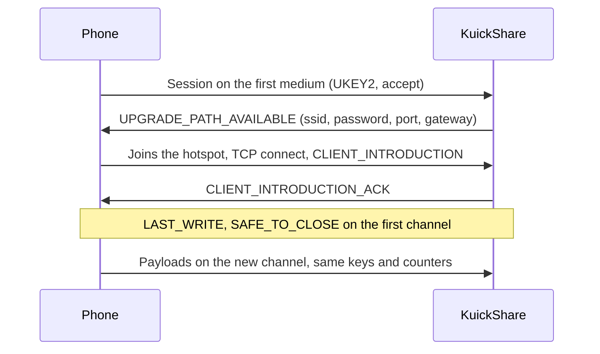

# Wi-Fi upgrade (transfers without a shared network)

> [!WARNING]
> Experimental and off by default (`WifiUpgrade`, Settings → Wi-Fi Direct). Tested only with a Pixel 7 and a Galaxy A55 (Samsung Quick Share, Android 16) on MT7922 adapters; see [Verified](#verified) and [Limits and unverified](#limits-and-unverified). *(inferred)* marks a cause or claim taken from logs and code, not reproduced. Problems and fixes are welcome as issues and pull requests.

| | |
|---|---|
| [What it does](#what-it-does) | The flow and the two directions |
| [Requirements](#requirements) | Software, privileges, firewall, Flatpak |
| [Checking the requirements](#checking-the-requirements) | What the app checks before you turn it on, and what it cannot |
| [Behaviour](#behaviour) | Discovery, sending, trust, cancel |
| [Timings](#timings-and-timeouts) | Scan windows, dial, watchdogs |
| [Sending over GATT](#sending-over-gatt) | Phones without an L2CAP channel |
| [Known behaviours](#known-behaviours) | Causes, handling and status |
| [Verified](#verified) · [Limits and unverified](#limits-and-unverified) | What ran on hardware and what did not |
| [Why not a P2P group](#why-not-a-p2p-group) · [Testing](#testing) · [References](#references) | |

## What it does

Quick Share starts on a cheap medium and can switch to a faster one (the *bandwidth upgrade*). With the setting on, a phone with Wi-Fi off and the computer find each other over Bluetooth Low Energy (BLE), start the transfer there and move it to a Wi-Fi link. If any step fails the transfer stays on the first channel.

| Direction | Who hosts the Wi-Fi | KuickShare does |
|---|---|---|
| Receiving from a phone | KuickShare | Starts an access point (NetworkManager serves DHCP), offers the credentials; the phone joins and the transfer continues there |
| Sending to a phone | The phone | Scans for the phone, connects over BLE (L2CAP, or GATT without a PSM), joins the Wi-Fi Direct group or hotspot the phone offers as a normal WPA2 client and continues there |

| Part | Where |
|---|---|
| Protocol: frames, hand-over state machine, timeouts, `WifiLink` trait | `third_party/rqs_lib/src/upgrade.rs`, handlers in `hdl/inbound.rs` and `hdl/outbound.rs` (see [THIRD_PARTY.md](../THIRD_PARTY.md)) |
| BLE receiver: `0xFEF3` advertisement, GATT "weave" service, bridge to a receive session | `third_party/rqs_lib/src/hdl/ble_receiver/` |
| BLE sender: windowed scan, L2CAP and GATT dial, central bridges | `hdl/ble_scan.rs`, `hdl/ble_send/` |
| Bluetooth devices in the app: `ble:` ids, `ScanBluetooth`, job steps, Send page | `src/core/app.rs`, `src/core/dbus.rs`, `src/shell/` (see [D-Bus API](dbus-api.md)) |
| NetworkManager backend (`NmLink`): hotspot and join over D-Bus | `src/core/link.rs` |
| Setting | `wifi_upgrade` in `settings.json`, D-Bus property `WifiUpgrade`; the firewall consent of a session is set with `RequestWifiUpgrade` (see [D-Bus API](dbus-api.md)) |

## Requirements

| Item | Detail |
|---|---|
| Network stack | NetworkManager with a Wi-Fi card that can run an access point; the `dnsmasq` package on the host (NetworkManager starts it for the `shared` IPv4 method). The [requirements check](#checking-the-requirements) looks for the binary at the standard paths (not in a Flatpak, see [In a Flatpak](#in-a-flatpak)), but cannot tell whether NetworkManager will start it: if the hotspot does not activate, the log carries only NetworkManager's reason code (`connection was deactivated (NetworkManager reason code N)`); a missing `dnsmasq` as the cause of such a failure is *(inferred)* |
| Medium | Receiving: `WIFI_HOTSPOT` (we host). Sending: `WIFI_DIRECT` or `WIFI_HOTSPOT` as the phone offers. A P2P group on our side is not used, see [below](#why-not-a-p2p-group) |
| Privileges | None |
| Firewall | Before NetworkManager is touched, the upgrade port (TCP, random per transfer) is opened in firewalld's `nm-shared` zone through its D-Bus API; it is closed at the end (it also expires after 300 s). The profile is put in that zone, which otherwise allows only DHCP, DNS, ssh and ICMP. There is no automatic fallback to another zone. If the port cannot be opened (firewalld not running, or polkit refuses `org.fedoraproject.FirewallD1.config`, the action firewalld's `addPort` requires; Fedora's polkit rule allows active local `wheel` users; any other firewalld error counts as a refusal and is logged) the hotspot is refused, nothing is changed in NetworkManager and the transfer stays on Bluetooth; the core emits `WifiUpgradeBlocked` with `firewall_denied` (firewalld refused) or `firewall_missing` (not running). Other firewalls (ufw, plain nftables) cannot be changed without root, so there the hotspot is always refused unless the user consents |
| Firewall consent | The user can allow an open zone for the rest of the session (`RequestWifiUpgrade(true, true)`, [D-Bus API](dbus-api.md#methods)); the shell asks when the setting is turned on while firewalld is not running (`FirewallManaged`) and after a `WifiUpgradeBlocked`. With it, a firewalld refusal puts the profile in the `trusted` zone (the phone reaches every service of the computer) and a missing firewalld leaves the zone to NetworkManager (another firewall may still block the phone). The consent is kept in memory only and does not survive a restart of the daemon and is revoked by `ResetSettings`, turning the upgrade off and any write of the legacy `WifiUpgrade` property; revoking it takes down a hotspot that already runs in an open zone (the transfer goes on over its first channel) |
| Wi-Fi on the host | With one radio the normal connection drops while the link is up and is re-activated when the transfer ends normally (not after a crash: NetworkManager then reconnects by itself). The daemon deletes every NetworkManager profile named `kuickshare-*` at start (unconditionally, whatever the settings say, before it takes its D-Bus name) and at stop; the cleanup times are in [Timings](#timings-and-timeouts) |
| Flatpak | The manifest grants `--system-talk-name` for NetworkManager and `org.fedoraproject.FirewallD1`, which do the privileged work on the host, so only `dnsmasq` is needed there; and for `org.freedesktop.PolicyKit1`, which the [requirements check](#in-a-flatpak) only asks, without interaction, whether firewalld will accept the port. Sending over Bluetooth also needs `--allow=bluetooth` (the L2CAP socket). Receiving was verified in the sandbox; sending was not (see [Limits](#limits-and-unverified)) |

## Checking the requirements

The core reads what the upgrade needs from the computer, judges it, and reports it as a list of requirements and three capabilities (the JSON is in [D-Bus API](dbus-api.md#wi-fi-requirements-report); the shell shows it in Preferences and in the "System requirements" dialog, see the [user guide](usage.md#checking-the-requirements)). All the judging is in the core (`src/core/requirements/`); the shell only renders. The check says what to expect, not what will happen: see [what is never verified](#what-is-never-verified).

### The capabilities

| Capability | Meaning |
|---|---|
| Sending | This computer can send to a phone: scan over Bluetooth, dial, and join the Wi-Fi the phone offers |
| Receiving | A phone can send to this computer: it advertises over Bluetooth and hosts the hotspot |
| Join network | This computer can join a Wi-Fi network received from a phone ([Join network](usage.md#receiving)); it does not depend on the upgrade setting |

Every requirement names the capabilities it feeds (`Affects` below) and has a category: `critical` for all of them except `bluez.l2cap` (`warning`), the firewall and sandbox rows (`security`), and `wifi.dhcp` in a Flatpak (`info`, see [In a Flatpak](#in-a-flatpak)). An `info` row feeds no capability. A capability is, from the rows that feed it:

| Capability | When |
|---|---|
| Unavailable | A critical row is Blocked |
| Unknown | No critical row is Blocked and one is Unknown |
| Limited (`degraded` on the bus) | Otherwise: any row is a Warning, or a row that is not critical is Blocked or Unknown |
| Available | None of the above |

So a missing service blocks only what needs it, a switch that could not be read never makes a capability Unavailable, and the firewall (a security row) can lower Receiving to Limited but never to Unavailable. A row whose dependency is not Ready is not checked (`skipped`).

### The requirements

Any row can also be Unknown for a generic reason: `timeout` (the call or the whole check ran out of time), `bus_unreachable` (no system bus), `malformed_reply`, `query_failed`, or `skipped`. Unknown never turns into Blocked: what could not be observed is not a verdict. The table lists the codes specific to a row (`reason_code`); `S`, `R`, `J` are Sending, Receiving, Join network.

| Id | What it checks | Affects | Ready | Warning | Blocked | Unknown (specific) |
|---|---|---|---|---|---|---|
| `bluez.service` | `org.bluez` has an owner | S R | Running | Installed, not running (`not_running_activatable`) | Not running (`not_running`); Flatpak may not talk to it (`sandbox_denied`) | |
| `bluez.adapter` | An adapter exists: `hci0`, else the first by name (the rule `bluer` uses in the runtime, copied by hand in `rules.rs`) | S R | One found | | None (`no_adapter`) | |
| `bluez.powered` | `Powered` and `PowerState` of that adapter | S R | On | Off (`powered_off`) | Blocked by rfkill (`rfkill_blocked`) | |
| `bluez.le` | `Roles` of the adapter | S R | Central or peripheral | | No LE role (`no_le_roles`) | BlueZ gives no roles (`roles_unreported`) |
| `bluez.advertising` | `LEAdvertisingManager1` of the adapter | R | Manager present, a free slot | No free slot (`no_free_slot`) | Adapter on, no manager (`unsupported`) | |
| `bluez.scanning` | `Roles` and `GetDiscoveryFilters` | S | Filters read | | Roles listed, none central (`no_central_role`) | BlueZ gives no filters (`filters_unreported`) |
| `bluez.transport` | `GattManager1` of the adapter | R | Present | | Adapter on, absent (`no_gatt_manager`) | |
| `bluez.l2cap` | The kernel lists the `L2CAP` protocol; in a Flatpak, the Bluetooth permission | S | Listed | Flatpak without Bluetooth (`sandbox_denied`) | | Not listed, or not readable (`kernel_unreported`) |
| `nm.service` | NetworkManager has an owner (its version goes in `details`) | S R J | Running | Installed, not running (`not_running_activatable`) | Not running (`not_running`); `sandbox_denied` | |
| `nm.networking` | `NetworkingEnabled` | S R J | On | | Off (`disabled`) | |
| `nm.wifi_enabled` | `WirelessEnabled` | S R J | On | | Off (`disabled`) | |
| `nm.hardware_enabled` | `WirelessHardwareEnabled` | S R J | On | | Hardware switch off (`switch_off`) | |
| `nm.device` | A Wi-Fi device exists, picked by [the shared rule](#the-wi-fi-device) | S R J | One found; with several Wi-Fi devices still Ready (`ok_first_of_many`) | | None (`no_wifi_device`) | |
| `nm.managed` | `Managed` of that device | S R J | Managed | | Not managed (`unmanaged`) | |
| `nm.firmware` | `FirmwareMissing` of that device | S R J | Present | | Missing (`firmware_missing`) | |
| `nm.driver` | `NmPluginMissing` and `State` of that device | S R J | Plugin present, state not "unavailable" | State "unavailable" while the radio is not switched off (`unavailable`; the state reason is in `details`) | Plugin missing (`plugin_missing`) | |
| `nm.permissions` | `GetPermissions` (no interaction): `network-control` and `settings.modify.system` | S R J | Both `yes` | Any is `auth` (`auth_required`) | Any is `no` (`denied`) | |
| `wifi.client` | Derived: the NetworkManager rows above, and in a Flatpak the network permission | S J | None of them Blocked or Unknown | | One is Blocked (`prerequisite_blocked`); Flatpak without network (`sandbox_no_network`) | One is Unknown (`prerequisite_uncertain`) |
| `wifi.ap` | `WirelessCapabilities` of the device and the `wifi.share.protected` permission | R | AP mode, WPA2 (CCMP and RSN), a band, share permission `yes` | No capability bits reported (`caps_unreported`); share permission `auth` (`share_auth_required`) | No AP mode (`no_ap_mode`), no WPA2 (`no_wpa2`), no 2.4 or 5 GHz (`no_band`, only when the adapter says the band bits are valid), share permission `no` (`share_denied`); `sandbox_no_network` | |
| `wifi.dhcp` | A `dnsmasq` executable at the standard paths (`DNSMASQ_PATHS` in `system.rs`), or a hotspot that started this session | R | Found (`binary_present`), or a hotspot started this session (`worked_this_session`) | Not found (`not_found`); NetworkManager reported that sharing failed to start (`shared_start_failed`, from its state reason 18 or 19 *(inferred from the NetworkManager headers, not checked against a running system)*) | | In a Flatpak (`sandbox_unobservable`, category `info`) |
| `firewall.integration` | firewalld, its zone list and what polkit says about changing it | R | See [below](#the-firewall-row) | | | |
| `sandbox.permissions` | `/.flatpak-info` (rows exist in a Flatpak only) | none | Everything needed is granted | Network, Bluetooth, or the talk permission for BlueZ, NetworkManager, firewalld or polkit is missing (`missing`, listed in `details`); the whole file system is visible (`filesystem_host`) | | File not readable |

The shell groups the rows by component (Bluetooth, NetworkManager, Wi-Fi adapter, dnsmasq, firewall, Flatpak permissions; `componentOf` in `src/shell/requirementsreport.h`) and gives each row that needs attention, and each Ready row with a note (a reason other than `ok`), a plain-language text and, where one helps, a command to copy (never run); the codes above are the stable part.

#### The firewall row

`firewall.integration` is the only row that reads firewalld and polkit. It is a security row, so it can only lower Receiving to Limited.

| Status | When |
|---|---|
| Ready | firewalld runs, polkit allows its change action without asking, and the zone `nm-shared` is in the zone list; or a port was opened this session ([session evidence](#session-evidence)) |
| Warning | firewalld is not running or not installed, so another firewall is not looked at either (`not_running`); a Flatpak that cannot talk to it (`sandbox_denied`); no `nm-shared` zone (`zone_missing`); polkit would ask for authentication (`permission_auth`); the user allowed an open zone for this session (`consent_given`) |
| Blocked | polkit denies the change (`permission_denied`); or the firewall refused the port in this session and no consent was given (`denied_this_session`) |
| Unknown | The permission cannot be verified (`permission_unverifiable`): polkit is not running or is hidden (a Flatpak without its talk permission), the call failed, or the zone list could not be read because the read action was not allowed without asking |

The polkit action ids are `org.fedoraproject.FirewallD1.config`, which firewalld's `addPort` requires, and `org.fedoraproject.FirewallD1.info`, which guards `getZones` (read in firewalld 2.5.2's D-Bus server code; no test runs against a real firewalld). The zone list is read only when the `info` action is allowed without interaction, because the call could otherwise prompt.

### What is never verified

These stay Unknown or Warning, or are not in the report at all, whatever the rows say:

| Not verified | What the report does instead |
|---|---|
| That a hotspot really starts | `wifi.ap` Ready means the adapter reports AP mode and WPA2 and the permission is `yes`, not that NetworkManager brings one up. Only a hotspot that started this session is evidence, and it settles `wifi.dhcp` only |
| The outcome of an authentication | A permission of `auth` (NetworkManager or polkit) is a Warning: whether the user is asked, or succeeds, is not tried |
| Activatable services | A service that is installed but not running is a Warning; the check never starts it and does not know whether it would start |
| Radio and regulation | Only the adapter's capability bits are read: not the regulatory domain, DFS, or whether the channel the hotspot asks for is allowed |
| Firewalls other than firewalld | ufw or plain nftables are not looked at; without firewalld the row is a Warning and the hotspot is refused unless the user consents (see [Firewall](#requirements)) |
| End to end | Nothing here sends a byte to a phone; see [Verified](#verified) for what ran with real devices |

### Read-only

The probes only read, by construction (`src/core/requirements/system.rs`): `NameHasOwner` and `ListActivatableNames` on the bus; `Get` and `GetAll` of properties; BlueZ's `GetManagedObjects` and `GetDiscoveryFilters`; NetworkManager's `GetDevices`, each device's `DeviceType` and `GetPermissions`; firewalld's `getZones`; polkit's `CheckAuthorization`; and the files `/.flatpak-info`, `/proc/net/protocols` and the `dnsmasq` paths. They never start a scan, switch a radio, open a port, save a profile, or ask for credentials.

- Every call to a service other than the bus daemon carries `NoAutoStart`, so asking about BlueZ, NetworkManager, firewalld or polkit never starts one that is installed but stopped.
- polkit is asked only when it is running, with flags 0 (no interaction). The subject is the daemon's own bus name, the one firewalld checks when the runtime calls it, so the answer is the one the runtime will get *(inferred: same subject, not compared on a real system, in or out of a Flatpak)*.
- firewalld's `getZones` is called only when polkit allows its `info` action without asking (see [the firewall row](#the-firewall-row)).
- Each call is limited to 2 s and a whole check to 6 s ([D-Bus API](dbus-api.md#methods)).

This was tested against fake D-Bus services in the unit tests, not hand-tested with real BlueZ, NetworkManager, firewalld or polkit, and no test ran against a real adapter or phone. That these calls are harmless on a real system is therefore by reading the code, not observed.

### The Wi-Fi device

NetworkManager can list several devices. The runtime uses **the first device of type Wi-Fi** (type 2; Wi-Fi P2P does not count) in `GetDevices` order, for the hotspot and for joining a network alike, and the report judges the same device: the rule is one function, `select_wifi_device` in `src/core/link.rs`. With more than one Wi-Fi device the others are ignored (`nm.device` says `ok_first_of_many`). The runtime reads the device types one at a time and stops at the first Wi-Fi device, and a device whose type cannot be read is skipped. The report reads every type and does not skip: if one cannot be read, the rows that depend on the device are Unknown, never judged on a different device than the runtime would use.

### When the report is refreshed

The core keeps the last report and serves it while it is fresh ([D-Bus API](dbus-api.md#methods) for the time to live and the 2 s rule for forced calls). A watcher with its own system bus connection (`watch.rs`) drops the cache when something changes that a row depends on:

| Event | Source |
|---|---|
| A service appears or vanishes | `NameOwnerChanged` for BlueZ, NetworkManager, firewalld (not polkit) |
| An adapter, or its advertising or GATT manager, appears or goes | BlueZ's object manager (device objects, which come and go with every scan, are ignored) |
| An adapter changes `Powered`, `PowerState` or `Roles` | BlueZ property changes |
| A device is added or removed; a switch, `Managed`, `State`, `FirmwareMissing` or `NmPluginMissing` changes | NetworkManager signals and property changes |
| The runtime learned something by acting | [session evidence](#session-evidence) |

After the last event the core waits 1.5 s (so a burst counts once) and runs one check, at most one run caused by events every 5 s; a check that ends after a newer event is not trusted and is followed by another. A new report that says something different is announced with `WifiRequirementsChanged`. There is no polling, and nothing is refreshed before a first report was asked for. If the system bus cannot be reached the watcher ends quietly and the report is then refreshed only by requests.

### Session evidence

Some things only show when the runtime acts. The core keeps them in memory for the life of the daemon (never saved, gone at restart) and folds them into the rows they concern:

| Evidence | Effect |
|---|---|
| A hotspot came up | `wifi.dhcp` is Ready (`worked_this_session`), and stays so |
| A hotspot did not come up | `wifi.ap` adds "the last hotspot attempt failed" to its `details` (the status is unchanged), unless one came up before |
| firewalld opened the upgrade port | `firewall.integration` is Ready, also if firewalld stops later, until a later attempt is refused. It is a fact of this session, not a check |
| The firewall refused the port | `firewall.integration` is Blocked (`denied_this_session`) for `firewall_denied` or `firewall_missing`, unless the user gave the [consent](#requirements) or the row is Ready anyway |
| The user gave or took back the consent | `firewall.integration` is a Warning (`consent_given`) while it is given and the firewall would not be Ready |

### In a Flatpak

`packaging` is `flatpak` when `/.flatpak-info` exists, else `appimage` when `APPIMAGE` or `APPDIR` is set, else `native`. In a Flatpak:

- The sandbox rows come from `/.flatpak-info`: the network, Bluetooth and system-bus talk permissions the sandbox has, user overrides included *(inferred from the file's content as the code reads it, not compared with a real override)*. A missing permission turns the service row into `sandbox_denied` and `sandbox.permissions` into a Warning.
- `dnsmasq` cannot be looked for on the host: Flatpak reserves `/usr` and only `--filesystem=host-os` shows the host's (flatpak-metadata(5)), and the manifest does not ask for it. `wifi.dhcp` is Unknown (`sandbox_unobservable`) with category `info`, so it does not lower Receiving; the shell reads "Checked when the first hotspot starts". A hotspot that comes up makes it Ready; NetworkManager's sharing failure makes it a critical Warning (`shared_start_failed`).
- polkit is asked as in a native install, through `--system-talk-name=org.freedesktop.PolicyKit1`. An override that removes it hides the name *(inferred: how the proxy answers `NameHasOwner`, as for the other services; not tested in a sandbox)*: `firewall.integration` is then Unknown (`permission_unverifiable`) and `sandbox.permissions` names `polkit`.

### The gate on turning the setting on

Turning **Receive and send without a shared network** on (it was off) is judged from Sending and Receiving, by `policy.rs`; turning it off is always allowed, and so is writing `true` while it is on. The stored setting only changes through that write: a service disappearing never turns it off.

| Sending / Receiving | Verdict |
|---|---|
| Both Unavailable | Refused: `RequirementsBlocked` ([errors](dbus-api.md#wi-fi-upgrade-errors)). The refusal needs a check that started after the request, not an old cached report |
| Both Available | Allowed |
| Either Unknown | Allowed; the result is uncertain |
| Otherwise (one direction usable, or Limited) | Allowed |

The shell applies the same rule to the last report: while both are Unavailable the switch is off and disabled (a setting that is already on stays enabled, so it can be turned off). The line under it, **Check system requirements…**, says when only one direction works or something could not be checked. It is a gate on what is proven, not a promise: "allowed" does not mean the transfer will work.

## Behaviour

| Topic | Behaviour |
|---|---|
| Discovery | Over the LAN as usual. For a phone that is not on it, the BLE receiver advertises the computer (under its device name, visible to anything in range) while the setting is on and the device is visible; nothing is sent without consent |
| LAN sessions | A LAN transfer never upgrades: the sender announces `WIFI_LAN`, and a receiver does not host a hotspot for a LAN peer. A phone on the same LAN refuses a hotspot upgrade (Nearby's own rule). A phone seen on the LAN and over Bluetooth is listed once, on the LAN |
| BLE speed | About 5 KB/s: a transfer over BLE is only useful if the upgrade succeeds |
| Network loss | When NetworkManager reports that the last connection is gone, LAN devices are dropped at once and one Bluetooth scan runs (nothing happens if another connection stays up). When a network comes back, discovery restarts (the list is kept), because the mDNS library checks for new interfaces only every 5 s *(inferred: the default of mdns-sd 0.21)*. Not tested with a phone; the Wi-Fi that KuickShare brings up itself also triggers the restart, which is harmless |
| LAN search | A phone seen only over Bluetooth makes the mDNS search restart every 5 s, up to 4 times, until its LAN entry shows up (it shares the 5 s limit with the send-time lookup below). The Bluetooth scan and the list are not touched |
| Route choice | A send to a LAN device first probes its TCP port (timeout in [Timings](#timings-and-timeouts)). If it fails the entry is dropped (`DeviceLost`) and the send goes to the single `ble:` entry with the same name and device type. If none is known, a Bluetooth scan window is started (or the running one is used) and the send waits for that entry (Bluetooth lookup in Timings); if it is not seen, or more than one matches, it fails with "The device is not reachable". A send to a `ble:` entry goes over the LAN instead when exactly one LAN entry has the same name and device type and its probe succeeds. If none is known, the send asks the LAN once: it restarts the mDNS search (the list is kept; at most every 5 s, only while discovery runs) and waits up to 1.5 s for that entry, else it stays on Bluetooth. Every decision is logged at info (`send stays on Bluetooth: ...`) without device ids or names; the ids are in the debug lines, which the hand-test scripts enable. The `TransferUpdated` events carry the id the user picked, whichever route was used (`Core::redirects`), and Cancel is mapped back the same way |
| Sending | To a phone in Receive mode (visibility Everyone), found by a short BLE scan (Send page and refresh button). The phone must show Quick Share's Receive screen. The sender announces `WIFI_HOTSPOT` and `WIFI_DIRECT` (the Pixel offered `WIFI_DIRECT` by itself), waits up to 10 s for the offer, and follows the unencrypted frames the phone uses after the upgrade (`supports_disabling_encryption`). A send that fails is reported at once with a notification that says what to check. The Send page cannot start another transfer while one is live |
| Receive screen | Seen on a Pixel 7 (Android 17, Play services 26.40.32) in `NearbySharing`: `FOREGROUND` (Receive open) advertises `allowGattConnections=true` and `allowBleL2capConnections=true`; `BACKGROUND` and `SCREEN_OFF` advertise both `false`, even with visibility Everyone set permanently. The Galaxy A55 stops advertising when no Quick Share screen is open and draws a new endpoint id (see [Known behaviours](#known-behaviours)) |
| Trusted devices | Not available over Bluetooth: trust is keyed on the sender's MAC read from its IP, which a BLE session lacks, and the phone's MAC on the Wi-Fi link is not the LAN one *(inferred)*. Every Bluetooth transfer asks for consent; the trust button is hidden and pairing is refused |
| Cancel by the user | Sends the sharing Cancel frame and a Disconnection (after completing a frame the cancel cut in the middle), closes the write side (FIN), waits up to 2 s for the phone to close, and only then ends the session so the Wi-Fi link is released. |
| Cancel by the phone | A cancel or disconnection frame, or a closed socket, is noticed while we write (a frame is read concurrently with the send; tested in memory only). Other frames read meanwhile (keep-alive, upgrade) are kept, up to 32, and handled in order after the send; the upgrade finishes before the chunks start in the runs seen |

## Timings and timeouts

| What | Value | Note |
|---|---|---|
| BLE scan window | 15 s for the list, 12 s for a send | The Pixel sends its full advertisement only about every 10 s, so a shorter window can miss it. A send interrupts a running list scan |
| No-PSM shortcut | The phone is dialled over GATT at its first sighting | Applies if it was heard without a PSM, first at least 10 s before (so a Pixel's full advertisement would have come), within the last 5 minutes, and no PSM has shown up since. Otherwise the scan waits out its window. |
| First frame of a send | About 18 s over L2CAP, 22 s over GATT | Most of it is the scan; watchdog `BLE_START_TIMEOUT` 40 s in `src/core/app.rs`, shell timer 45 s in `corebridge.cpp` |
| GATT dial | 22 s in all, 10 s per `connect` (the Galaxy needed 5.8 s once) | If BlueZ drops the device object after a cancelled connect, the dial lists it again with a short discovery (up to 5 s). |
| Worst case of a send | Over 40 s if it waits for BlueZ to stop a discovery (up to 2 s) before the dial | The UI then reports a failure while the send may go on *(inferred from the code, not seen)* |
| LAN send: probe | 1.5 s (`PROBE_TIMEOUT`) | TCP connect before the send; a failure means the phone is gone |
| Bluetooth lookup after a failed LAN probe | Up to 3 s (`BLE_LOOKUP_TIMEOUT`, polled every 100 ms) | Only with the Wi-Fi upgrade on and no `ble:` entry known; ends early on a match or on several matches |
| LAN send: connect, handshake | 8 s, 20 s | Enforced by the library, which reports the failure; watchdog `LAN_START_TIMEOUT` 40 s in `src/core/app.rs` is only a safety net |
| mDNS resolve probe | 3 s | The library checks that a resolved device answers before listing it |
| Join to the phone's network | 4 attempts of 4.5 s of scan polling, hidden-SSID attempts from the third, budget 15 s | The phone gives up after about 15 s. See [first join fails](#known-behaviours) |
| First encrypted frame over BLE | Waits 200 ms | See [Known behaviours](#known-behaviours). |
| Write stall (file send) | 30 s | The user's cancel works at once; a phone that vanishes without FIN or RST is noticed only after this |
| Disconnect and cancel waits | 2 s each; GATT disconnect 5 s | |
| Engine stop at exit | 0.8 s in all (`SHUTDOWN_ENGINE_BOUND`, the wait for the `Core` lock included); inside it the library gets 0.5 s (`SHUTDOWN_STOP`) and the event forwarder 0.2 s | In `src/core/app.rs`. Runs first; on a timeout the log warns and the Wi-Fi cleanup still runs. A restart of the engine allows the library 3 s instead |
| Library wind-down at a stop | 400 ms (`STOP_WIND_DOWN` in `third_party/rqs_lib/src/manager.rs`) | An inbound session sends its Cancel and Disconnection frames, then a FIN, within 300 ms (`Limits::stop_close`) + 50 ms (`FIN_TIMEOUT` in `hdl/inbound.rs`); it stays below the engine bound above |
| Wi-Fi cleanup | 2 s at stop (`WIFI_STOP_CLEANUP_BOUND`), 5 s for the sweep at start (`WIFI_START_SWEEP_BOUND`), both in `src/core/app.rs` | Always runs after the engine stop. Engine stop (0.8 s) and cleanup (2 s) together stay within the shell's 3 s wait after SIGTERM (`corebridge.cpp`); on a timeout the log warns that a hotspot or an open firewall port may remain. Change one, check the others |

## Sending over GATT

A phone that advertises no PSM (the Galaxy A55 with Samsung Quick Share, whose advertisement ends after the token with no mask byte: the parser accepts that) is sent to as the GATT central of the Nearby "BLE socket", with the same send session as over L2CAP. `find_target` keeps scanning until the end of its window for a PSM and falls back to the sighting without one, unless the [shortcut](#timings-and-timeouts) applies; `BleScanner::send` then picks `dial_l2cap` or `dial_gatt`. GATT carries only the handshake and the upgrade offer, so its speed (a few KB/s) does not matter.

| Part | Where |
|---|---|
| Central side of weave (connection request, confirm, framing) | `ble_send/weave_central.rs`, reusing `Packetizer`/`Reassembler` of `ble_receiver/weave.rs` |
| Bridge between the GATT channels and the session stream | `ble_send/gatt_bridge.rs` (`GattCentralBridge`, `GattLink`); `send_over_gatt` in `ble_send/mod.rs` shares the session driving with `send_over_l2cap` |
| BlueZ dial: connect, find the service holding the Nearby characteristics, subscribe, write | `ble_send/gatt_dial.rs` (`dial_gatt`) |

The Galaxy A55 exposes two 0xFEF3 services, one with the five slot characteristics and one with `…1a11000101` (`write`, with response) and `…1a11000102` (`indicate`); ATT MTU 517, so packets of 509 bytes; it connects without pairing. `dial_gatt` picks the service that holds both Nearby characteristics, writes one packet at a time and subscribes with `StartNotify`, which also covers indications.

## Known behaviours

Causes marked *(inferred)* come from logs and code, not from a reproduction.

| Behaviour | Cause and handling |
|---|---|
| **First join fails** with `the access point was not found`, then the second attempt joins | On a laptop already associated to another network, the phone's group first appears in NetworkManager's list about 6 s after the offer (Pixel, 5805 MHz: offer 11:20:58.1, listed 11:21:04.3; sampled every 0.5 s with `nmcli device wifi list --rescan no`) because a scan of an associated radio visits the channels in turns. `RequestScan` takes no channel list, so the scan cannot be shortened; asking again every 1.5 s did nothing. The first attempt (4.5 s window) fails and the second joins at once, 6-8 s after the offer; a longer window would save only the 1 s retry pause and push the hidden attempts out of the budget. On the desktop (idle radio) the group is listed sooner |
| **`GattDial: disconnect timed out`** | Our timer (now 5 s) ran out; BlueZ sent the HCI disconnect 0.3-0.6 s later with status 0 and the Galaxy never closes the LE link. The link closes and the transfer is unaffected. No controller error appeared in `btmon`; the kernel log was not captured then, so a Bluetooth/Wi-Fi coexistence problem is not excluded (it did not recur) |
| **GATT handshake dropped by the phone** (2 of 3 sends to the Galaxy) | The phone parsed our first encrypted frame as a plain one (`invalid OfflineFrame`, then `Incorrect sequence number`); the frame arrived within about 10 ms of its own ConnectionResponse and the packets in `btmon` were identical to the good send *(inferred race on the phone)*. Over Bluetooth the first encrypted frame now waits 200 ms |
| **A phone draws a new BLE endpoint id** (the Galaxy: `ARWA` became `4IX7` after its screen was locked and unlocked) | A send to the old list entry never found it. When the id is not seen in the window but exactly one other sighting has the same advertised name (and the same device type, when the scan remembers the old one), the send uses that phone and logs `ble:ARWA is now ble:4IX7 (same name)`; the transfer keeps the list entry's id. Two phones with the same name are not guessed between and the error says so; a stranger's phone with the same default name and no other one around would be taken for it, but the phone still has to accept. |
| **A phone on the LAN is listed only over Bluetooth for seconds** | With both phones steady on the LAN and on the Receive screen, the mDNS record resolved 0.0-2.7 s after each of 5 starts of the search. The record appears and disappears with the phone's own advertising: the Pixel's `NearbySharing` log shows `Start advertising with mode FOREGROUND` at 14:25:11.75 and our `ServiceResolved` came at 14:25:11.83; its `ServiceRemoved` came when it stopped. In the `BACKGROUND`/midground modes it advertises over Bluetooth only, so a send to the `ble:` entry first asks the LAN (restarting the search, up to 1.5 s) and the list repeats that search every 5 s, up to 4 times, for a phone seen over Bluetooth without a LAN entry *(inferred cause: the phone's advertising mode, not a delay of the library)* |
| **The Galaxy appears late or not at all in the list** | Its Quick Share stops advertising when no Quick Share screen is open ("no scanning phone nearby and no receive surface in foreground") and in short bursts otherwise (37 s and 3 s in its `dumpsys bluetooth_manager`), and reopening the Receive screen did not always restart it; seen in `btmon` and its `logcat`, the cause is theirs. Not verified: whether the Galaxy sends its own socket introduction (the code tolerates both) |
| **"the discovery ended before the window did"** (3 sends in one session, 0.8-11.6 s into the window) | `bluetoothd` itself sent the mgmt Stop Discovery 6-15 ms before the error (ours takes 50 ms or more); no list scan was running and every scan has its own D-Bus connection, so the cause is not identified. In a later session the same error followed 20 ms and 3.3 s after a restart of the whole discovery (the Bluetooth advertisement is registered again and a new scan window starts), so a send to a Bluetooth entry now restarts only the mDNS search *(inferred)*. A send also scans the window once more when it happens. |
| **`mdns_sd` logs `Network is unreachable`** to 224.0.0.251 on the hotspot interface, as host (192.168.49.1) and as client (.5, .154) | No multicast route there *(inferred)*; mDNS now ignores the whole `192.168.49.0/24`, so a real LAN on that subnet loses mDNS (the same clash the fixed hotspot subnet has). (The error was absent in one later session.) On the laptop it still logs transient errors during and after a join (IPv4 `224.0.0.251`, IPv6 `ff02::fb` with `os error 99`) |
| **Benign log lines** | ATT "Attribute Not Found" probes after a GATT send, `Reject scan trigger since one is already pending`, `mdns_sd` closed-channel errors when the daemon exits, `hci0: Opcode 0x202d failed: -16` when advertising starts |
| **A phone that cancels by tearing the Wi-Fi Direct group down** (the Pixel's `WifiP2pService` dropped the group; no FIN or RST reached us) | Noticed only when a write stalls for 30 s. A `TCP_USER_TIMEOUT` on the stream, or cancelling when the link goes away, would shorten it *(not done)* |
| **BLE re-advertising and `Device::disconnect` side effects; the GATT notify race** (a rewrite with `CharacteristicNotifyMethod::Io` would bind the session to the subscriber); **phones on the LAN not rechecked** after the BLE scanner was removed | Weaknesses without a reproducible cause |
| **MT7922 reset once during a scan** (`LE Set Extended Scan Enable` timeout, USB reset, firmware reload) | The next attempt worked; the cause was not investigated |

## Verified

All with the MT7922 adapter, a Pixel 7 and a Galaxy A55 (Samsung Quick Share 13.8.52.3, Android 16).

| Test | Result |
|---|---|
| Receive from the Pixel 7 (we host a hotspot) | OK |
| Send to the Pixel 7 (it hosts a Wi-Fi Direct group, we join as WPA2 client) | OK; a 328 MB file arrived intact at about 55 MB/s |
| Receive from the Galaxy A55 (BLE GATT, then it joins our 5 GHz hotspot) | OK; about 329 MB in about 16 s (about 20 MB/s), the file was not compared after the transfer |
| Send to the Galaxy A55 (BLE GATT, then the group it offers) | OK; a 329 MB video took about 5 s on the Wi-Fi leg (about 65 MB/s from the log timestamps), same SHA-256 as the original (checked with `sha256sum` on the phone through `adb`). GATT link up in 1.7 s, MTU 512 |
| Send over GATT to the Pixel 7, forced with `KS_TRANSPORT=gatt` (`send_small_file_to_phone`, 8 KB) | OK; link up in about 5 s, MTU 512. The phone then sends a weave error packet; the bridge reports it as `Protocol`, which does not fail the transfer |
| Whole send session over GATT with the upgrade, against our own receiver | In-memory loopback tests (`ble_send/gatt_tests.rs`), including 20-byte packets |
| Laptop (Fedora 45, NetworkManager 1.58, MT7922 associated to the home Wi-Fi) | Send to both phones and receive from both: OK; the home connection returned about 0.6 s after the transfer; no `kuickshare-*` profile left; the join took 6-8 s after the offer |
| Plain frames after the upgrade, the phone's `CLIENT_INTRODUCTION` endpoint id (the receiver checks it), an advertisement without the "RxInstantConnectionAdv" field | Work on both phones |
| NAT | While the hotspot is up NetworkManager adds `masquerade` for `192.168.49.0/24` leaving the subnet and forward rules limited to the hotspot interface and that subnet; gone afterwards. `net.ipv4.ip_forward` stays `0`, so nothing is routed to another network |
| Plasma job | Step texts ("Looking for the device…", "Connecting…", "Waiting for the other device to accept", "Sending files", "Receiving files") and terminate/progress updates reach the tracker (`org.kde.JobViewV3`); the popup showed title, progress bar and Cancel for a receive; the other step texts were seen only in the capture |
| Kernel log around transfers | No `btusb`/`mt79xx` reset or Wi-Fi timeout |
| Android and the hotspot | Android drops a network it validated as having no internet when joined from Settings; Nearby joins programmatically and no drop was seen in the logged transfers |

## Limits and unverified

No other phone is available, so these cannot be closed by the project:

| Limit | Detail |
|---|---|
| Other hardware | Other phones and Wi-Fi chips, two phones at once, DFS and regulatory domains (channel 36 with fallback to 2.4 GHz). Whether other phones need the Receive screen like these two do, and whether `MIDGROUND` (seen once on the Pixel) ever advertises GATT without L2CAP |
| `UPGRADE_PATH_REQUEST` | Receivers that do not offer an upgrade by themselves (the Pixel and the Galaxy do) would need the sender to request it. Not implemented, not testable without such a phone |
| Our own group owner | Not implemented, see [below](#why-not-a-p2p-group); the hotspot is the supported way to receive |
| Firewalls | Only firewalld on Fedora was tried, and not since the consent rule above: the refusal, the consent and the zone choice are covered by tests with a fake NetworkManager and firewalld and were not hand-tested with a phone. With ufw or nftables the hotspot is refused unless the session consent is given; with it the zone is left to NetworkManager and their rules may block DHCP and DNS *(not tested)*. Polkit refusing the firewalld change was not tried; the confirmation check is not tested inside Flatpak or the AppImage |
| Flatpak | Sending was not verified in the sandbox |
| Requirements check | Tested against fake probes and fake D-Bus services only. Not run against a real BlueZ, NetworkManager, firewalld or polkit, in or out of a Flatpak; whether its rows match what a real system does (for instance the NetworkManager reason codes and the polkit subject marked *(inferred)* above) is open |
| Keeping the Wi-Fi up while a laptop joins a phone | Needs a second Wi-Fi interface (the MT7922 reports `#{ managed, P2P-client } <= 2` on up to 2 channels), created with root; not planned. See [Second Wi-Fi interface](#second-wi-fi-interface-idea-not-planned) |

### Second Wi-Fi interface (idea, not planned)

Kept as a note, not worked on. A virtual interface (`iw dev <if> interface add <name> type managed`, root) would let the laptop stay on its network. What it would take: `select_wifi_device` (`link.rs`, [the shared rule](#the-wi-fi-device)) picks the **first** Wi-Fi device NetworkManager lists, without checking its state, connection or access-point capability, so a second interface is ignored today; the choice would have to prefer a device that is not carrying the active connection, check `WirelessCapabilities` when hosting, and skip `remember_previous` and the restore; the card must allow the combination; and the interface must be created outside the app. The Flatpak sandbox has no way to do that (no `org.freedesktop.Flatpak`, polkit only answers authorization checks, no `iw`, and NetworkManager's D-Bus API does not create Wi-Fi interfaces), and the tarball and AppImage installers install nothing privileged (no polkit rule, udev rule or unit): it would be the first privileged host piece and would end "Privileges: None".

## Why not a P2P group

Creating a real Wi-Fi Direct group owner through wpa_supplicant's D-Bus works at the driver level, but NetworkManager 1.56 adopts the new `p2p-<if>-N` supplicant interface and removes it about 80 ms later. Marking the interface or `p2p-dev-<if>` unmanaged did not prevent it. Reading `Group.SSID` on a destroyed group also crashes wpa_supplicant 2.11. The hotspot path avoids both.

Findings from the hand test (MT7922, Pixel 7): a NetworkManager AP-mode hotspot is visible to the phone and accepts WPA2. A DHCP server of our own had to answer by unicast to the client's MAC because the phone never accepted broadcast offers; NetworkManager's `dnsmasq` (`ipv4.method=shared`) works in both directions, so our server was removed.

## Testing

`cargo test -p rqs_lib` runs the hand-over (plain and encrypted), the Bluetooth receiver and sender and the scanner in memory and over loopback with a fake `WifiLink`; `cargo test --all-features` covers `link.rs` with a fake NetworkManager. The requirements engine and its probes are covered with fake probes and fake D-Bus services (`src/core/requirements/`). Neither needs hardware. A send through a real adapter has no automated test (it would need a fake BlueZ inside `rqs_lib`); only the `#[ignore]` hardware tests, run by hand, cover it.

The real link needs a manual test (Wi-Fi card, Bluetooth adapter, phone, `adb logcat` and `btmon` captures): see [CONTRIBUTING.md](../CONTRIBUTING.md#hand-tests-with-a-phone-wi-fi-upgrade-and-bluetooth). The scripts in [`scripts/testing/`](../scripts/testing) (`run.sh`, `test-wifi.sh` for the desktop, `test-laptop.sh` for a laptop over ssh) are described in CONTRIBUTING.md. For a phone-side capture use `adb logcat -s NearbyConnections NearbyMediums NearbySharing WifiP2pService` (offered medium, `supports_disabling_encryption`, join latency, invalid frames, `allowBleL2capConnections`) together with the daemon log and `btmon -w`, also with a phone on another network and on the same LAN.

## References

| Project | Use here |
|---|---|
| [google/nearby](https://github.com/google/nearby) | Reference for frame order, timeouts and credentials (`bwu_manager.cc`) |
| [quickshare-direct](https://github.com/papshmeare/quickshare-direct) | Linux implementation of both directions, tested on a Pixel; source of the timing notes |
| [open-quickshare](https://github.com/ignotusbucius/open-quickshare) | Same idea over `nmcli`; client join and role switch |
| [Bada #256](https://github.com/kyujin-cho/Bada/issues/256) | For a send that starts on a slow medium the sender may have to request the upgrade itself *(not implemented)* |
